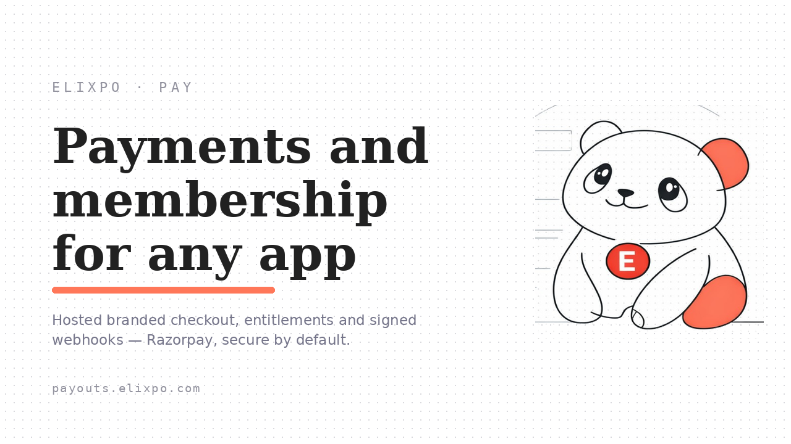
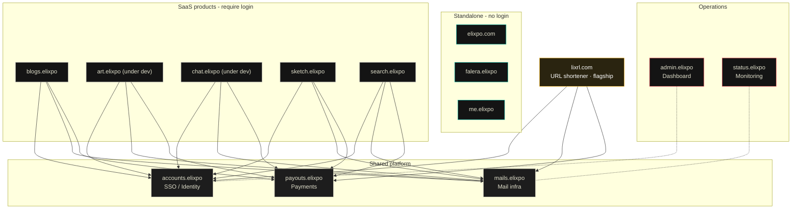

<p align="center">
  
</p>

<h1 align="center">Elixpo Pay</h1>

<p align="center">
  <strong>Hosted checkout, subscriptions, and access control for your app, with one API key and one webhook.</strong><br/>
  Shared payments infrastructure for the open Elixpo ecosystem of AI and developer tools.
</p>

<p align="center">
  <a href="https://payouts.elixpo.com">payouts.elixpo.com</a> ·
  <a href="https://payouts.elixpo.com/docs">Documentation</a> ·
  <a href="https://github.com/orgs/elixpo/discussions">Discussions</a> ·
  <a href="https://github.com/elixpo/elixpo_chapter">Monorepo</a>
</p>

---

## About

**Elixpo Pay** is the multi-tenant payments and payouts service for the Elixpo
ecosystem, and for any developer who wants to charge for access. Your server
starts a checkout, the buyer pays on a hosted page, and Elixpo Pay records what
they bought and tells your app to **switch them on**. When the paid period
ends, it tells your app to **switch them off**.

No card data reaches your app. You don't need to build a subscription database.
You never send an amount: prices come from a catalog that you manage in code.
Merchants sign in with **Elixpo Accounts** (SSO). Within the ecosystem, Elixpo
Pay handles billing for the other Elixpo products.

> This repository is the source for the **payouts.elixpo.com** hosted service.

### Who it's for

Developers and businesses who want one-time purchases or recurring memberships
in their app without building a payments system themselves. This includes
Elixpo's own products and outside apps.

### Why it's different

- **🔒 No card data, ever.** Payments happen on a hosted checkout. Your app only
  learns "this buyer now has tier X until date Y."
- **🔁 One-time and autopay.** One-time purchases go through Razorpay Orders.
  Recurring tiers use Razorpay autopay (UPI AutoPay and card e-mandates under
  RBI rules). The same API call handles both, and the price type decides which
  flow runs.
- **🧾 Pricing as code.** You declare your products and regional prices in JSON
  and push them with `POST /v1/sync`. The amount a buyer pays is looked up from
  your catalog, so nobody can tamper with it.
- **🔔 Signed webhooks.** `entitlement.updated` fires on every grant, renewal,
  cancellation, and expiry. `payment.captured` is optional. Both are
  HMAC-signed, and your app can also read entitlements whenever it needs to.
- **🔑 Key rotation without downtime.** Each app gets a secret key (`lix_pay_…`)
  and a webhook signing secret. When you rotate one, you can keep the old value
  valid for a short grace window, and webhooks are signed with both secrets
  during that window.
- **📬 Buyer emails included.** Receipts, cancellation notices, failed-renewal
  alerts, and expiry notices go out through
  [Elixpo Mails](https://mails.elixpo.com), from your own mailbox.
- **🏦 Connected payouts.** You can connect your bank so that your share of
  each payment is routed to you (Razorpay Route).

### How it works — in four steps

1. **Create a product.** Sign in with Elixpo Accounts and create a product in
   the dashboard. You get a secret key and a webhook signing secret.
2. **Sync your catalog.** Push your tiers and prices from code with
   `POST /v1/sync`.
3. **Start a checkout.** When a user upgrades, your server calls
   `POST /v1/checkout/sessions` and redirects the buyer to the hosted checkout
   URL that comes back.
4. **Receive the webhook.** Once the payment is confirmed, Elixpo Pay grants
   the entitlement, sends `entitlement.updated` to your app, and returns the
   buyer to your `success_url`.

After that, renewals, cancellations, and expiry keep your app in sync through
the same webhook.

### Built on

Elixpo Pay runs entirely on **Cloudflare's edge**: Next.js 15 on Cloudflare
Pages (edge runtime), with **D1** for the relational ledger and **KV** for
idempotency, handoff, and replay protection. Payments go through **Razorpay**
(INR). Stripe for international payments is coming soon. Merchants sign in
through **Elixpo Accounts** (SSO), and buyer emails go through **Elixpo Mails**.

## The ecosystem

| Tool | What it does | Link |
| --- | --- | --- |
| 🎨 **Elixpo Art** | AI image generation _(under dev)_ | [art.elixpo.com](https://elixpo.com) |
| ✍️ **Elixpo Blogs** | A rich, modern writing and publishing space | [blogs.elixpo.com](https://blogs.elixpo.com) |
| 🖊️ **LixSketch** | A hand-drawn style whiteboard for ideas and diagrams | [sketch.elixpo.com](https://sketch.elixpo.com) |
| 💬 **Elixpo Chat** | A fluid, real-time AI chat experience _(under dev)_ | [chat.elixpo.com](https://chat.elixpo.com) |
| 🔎 **Elixpo Search** | Fast, AI-assisted search | [search.elixpo.com](https://search.elixpo.com) |
| 👤 **Elixpo Accounts** | One identity (SSO) across the ecosystem | [accounts.elixpo.com](https://accounts.elixpo.com) |
| 📬 **Elixpo Mails** | Branded transactional email, triggered by your product's events | [mails.elixpo.com](https://mails.elixpo.com) |
| 💳 **Elixpo Pay** | Payments, subscriptions, and payouts _(this repo)_ | [payouts.elixpo.com](https://payouts.elixpo.com) |
| 🔗 **lixrl** | Our flagship URL shortener | [lixrl.com](https://lixrl.com) |
| 🪪 **Portfolios** | Personal pages to showcase your work | [me.elixpo.com](https://me.elixpo.com) |
| 🐼 **Falera** | The open conference badge and FaleraOS | [falera.elixpo.com](https://falera.elixpo.com) |

Developers can drop our editors into their own projects with the
**`@elixpo/lixsketch`** and **`@elixpo/lixeditor`** packages, on npm and as VS
Code extensions.

## Architecture

Everything runs on **Cloudflare**. Three shared platform services back the
ecosystem, and products are either **SSO-backed SaaS**, **standalone**, or our
**flagship**:

- **`accounts.elixpo`** - single sign-on / identity
- **`mails.elixpo`** - shared mailing infrastructure
- **`payouts.elixpo`** - shared payments / payouts

SaaS products (Blogs, Art, Chat, Sketch, Search) and the flagship **lixrl.com**
all authenticate through Accounts (SSO) and share the Mail and Payouts infra.
The public, login-free surfaces (**elixpo.com**, **falera.elixpo**, **me.elixpo**)
are standalone. **admin.elixpo** is the operations dashboard and
**status.elixpo** is monitoring.



A rendered, interactive version lives at **[elixpo.com/architecture](https://elixpo.com/architecture)**.

## For developers

The full guide lives at **[payouts.elixpo.com/docs](https://payouts.elixpo.com/docs)**.
It covers the quickstart, catalog sync, checkout sessions, webhooks, the
entitlements API, buyer emails, and connected payouts.

### Integration quickstart

Start a checkout from your server with your app's secret key:

```bash
curl -X POST https://payouts.elixpo.com/v1/checkout/sessions \
  -H "Authorization: Bearer $ELIXPO_PAY_API_KEY" \
  -H "Content-Type: application/json" \
  -d '{
    "tier": "member",
    "currency": "INR",
    "interval": "month",
    "customer": { "uid": "u_123", "email": "buyer@example.com" },
    "success_url": "https://yourapp.com/settings"
  }'
```

The response includes a hosted checkout `url` (`https://payouts.elixpo.com/checkout?session=cs_…`).
Redirect the buyer to that URL. `interval` is optional and only needed when a
tier is sold both monthly and yearly. `success_url` must be an absolute
`https://` URL. Sessions expire after 30 minutes.

The API at a glance (all calls are authenticated with `Authorization: Bearer lix_pay_…`):

| Endpoint | Purpose |
| --- | --- |
| `POST /v1/checkout/sessions` | Create a checkout session and get back a hosted checkout URL |
| `GET /v1/entitlements?app=<slug>&uid=<uid>` | Read a buyer's current tier, status, and expiry |
| `POST /v1/sync` | Sync your whole product and price catalog from code |
| `POST /v1/products` | Sync a single product and its tiers |
| `POST /v1/subscriptions/cancel` | Cancel autopay. By default the buyer keeps access until the end of the paid period |
| `GET /v1/catalog?app=<slug>` | Public, read-only catalog for rendering your pricing page (no key needed) |

**Webhooks.** Elixpo Pay sends `POST` requests to your endpoint with the
`X-Elixpo-Pay-Event`, `X-Elixpo-Pay-Timestamp`, and `X-Elixpo-Pay-Signature`
headers. To verify a request, compute `HMAC_SHA256(signing_secret, "<timestamp>.<raw body>")`
and accept it if the result matches **any** of the comma-separated
`sha256=…` values in the signature header. During a secret rotation, the
header carries signatures from both the current and the previous secret.

**Buyer emails.** In the dashboard, go to your product → *Buyer emails ·
Elixpo Mails* and paste a Mails trigger URL for each event: `payment.receipt`,
`subscription.cancelled`, `payment.failed`, and `access.expired`. Include the
buyer's `email` when you create checkout sessions. That address is where these
emails are sent.

### Running locally

```bash
npm install
npm run dev
```

Then open [http://localhost:3000](http://localhost:3000).

Useful scripts (see `package.json` for the full list):

```bash
npm run build              # Production build
npm run pages:build        # Build for Cloudflare Pages (@cloudflare/next-on-pages)
npm run lint               # Biome check
npm run format             # Biome check --write
npm run typecheck          # tsc --noEmit
npm run db:migrate         # Apply D1 migrations (remote)
npm run db:migrate:local   # Apply D1 migrations (local)
./biome.sh ci              # Strict Biome check, the same one CI runs
```

D1 migrations live in `src/workers/migrations/`, and the bindings (`DB`, `KV`)
are declared in `wrangler.toml`.

### Configuration & deployment

Runtime configuration is read from `.env.local` in development and from
Cloudflare Pages secrets in production. The committed `.env` is
sops-encrypted. Run `./sops-reencrypt.sh --decrypt` to get a plaintext
`.env.local`. The main groups of variables are:

- **Elixpo Accounts SSO:** `NEXT_PUBLIC_ELIXPO_CLIENT_ID`, `ELIXPO_CLIENT_SECRET`, `NEXT_PUBLIC_ACCOUNTS_URL`, `ACCOUNTS_WEBHOOK_SECRET`
- **App & sessions:** `NEXT_PUBLIC_APP_URL`, `ELIXPO_PAY_SESSION_SECRET`, `ELIXPO_PAY_HANDOFF_SECRET`, `CRON_SECRET`
- **Razorpay:** `RAZORPAY_MODE` (`test` / `live`) plus `RAZORPAY_{TEST,LIVE}_KEY_ID`, `…_KEY_SECRET`, `…_WEBHOOK_SECRET`
- **Local only:** `CLOUDFLARE_*` credentials for the D1/KV REST fallback (production uses bindings)

Merging to `main` deploys through the shared Elixpo Cloudflare Pages workflow
(`.github/workflows/deploy.yml`). That workflow applies the D1 migrations,
syncs secrets from the encrypted `.env`, and runs `npm run pages:build`.
[`deploy.sh`](deploy.sh) does the same steps by hand
(`./deploy.sh [secrets] [build] [deploy]`). `NEXT_PUBLIC_*` values are
included in the build at build time, so make sure they hold production values
before you build. A daily GitHub Action calls `/api/cron/expire-entitlements`
to downgrade memberships that have lapsed.

## Built by the community

Elixpo is made by people, in the open. **45+ contributors** have shaped these
tools, with a small core team steering the way:

- **Ayushman Bhattacharya** - Founder & Lead ([@Circuit-Overtime](https://github.com/Circuit-Overtime))
- **Vivek Yadav** - Lead Co-Dev ([@ez-vivek](https://github.com/ez-vivek))
- **Anwesha Chakraborty** - Core Maintainer ([@anwe-ch](https://github.com/anwe-ch))

Everyone is welcome. See **[CONTRIBUTING.md](CONTRIBUTING.md)** and our
**[Code of Conduct](CODE_OF_CONDUCT.md)**.

## Recognition & programs

Elixpo has taken part in and been supported by **GSSOC**, **Hacktoberfest**,
**Pollinations.AI**, **MS Startup Foundations**, and **OSCI**.

## Get involved

- 💬 **Join the conversation** in [GitHub Discussions](https://github.com/orgs/elixpo/discussions).
- 🚀 **Submit your project** to be featured across the ecosystem.
- 🛠️ **Contribute** - browse good first issues in the [monorepo](https://github.com/elixpo/elixpo_chapter).

For security issues, please report them privately as described in
[SECURITY.md](SECURITY.md) instead of opening a public issue.

## Brand assets

Brand-ready marks and icons live under [`public/`](public/). The ecosystem brand
source of truth (mascot, palette, rules) is at
**[elixpo.com/assets](https://elixpo.com/assets)**.

## License

The code is licensed under the [MIT License](LICENSE). Brand and visual assets
are licensed under [CC-BY-4.0](LICENSES/preferred/CC-BY-4.0). The Elixpo and
Lumi names, the Lumi mascot, the E-badge mark, and elixpo.com domains are covered by
[`TRADEMARKS.md`](TRADEMARKS.md), not by either licence. See also the repository
[notice board](LICENSES/NOTICE) and [third-party notices](LICENSES/notices/notice-board).

## Exclusive

> Per-repo "exclusive" artifacts (an npm package, a VS Code extension, a hosted
> SaaS, a paid tier) are declared here and in [`NOTICE`](LICENSES/NOTICE).

**This repository:** Elixpo Pay is an official **hosted SaaS** at
[payouts.elixpo.com](https://payouts.elixpo.com). The brand, the hosted
deployment, the operational and merchant data, and the per-app API credentials
and signing secrets are reserved, and any **paid tier, plan, entitlement grant,
or commercial billing** operated under the Elixpo Pay brand is reserved. The
source is MIT - forks must operate under a different name.

---

<p align="center"><sub>Made in the open, together. © 2026 Elixpo Pay · Paid with care.</sub></p>
