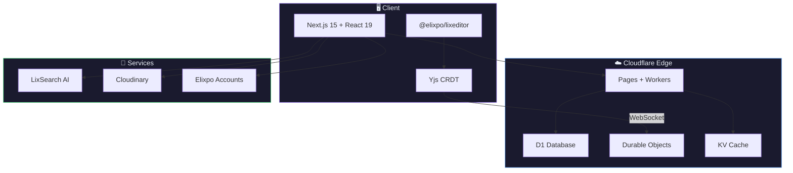

<div align="center">


# LixBlogs

### Write, collaborate, and publish beautifully.

A modern blogging platform with a rich block editor, AI writing assistant,<br />
real-time collaboration, and organizations — all on the edge.

<br />

[](https://blogs.elixpo.com)
[](https://github.com/elixpo/blogs.elixpo)
[](https://www.npmjs.com/package/@elixpo/lixeditor)
[](https://marketplace.visualstudio.com/items?itemName=elixpo.lixeditor)
[](LICENSE)

[](https://nextjs.org)
[](https://react.dev)
[](https://pages.cloudflare.com)
[](https://tailwindcss.com)
[](https://blocknotejs.org)

[Website](https://blogs.elixpo.com) ·
[Discussions](https://github.com/orgs/elixpo/discussions) ·
[Elixpo](https://elixpo.com) ·
[Chapter](https://github.com/elixpo/elixpo_chapter)

</div>

<br />

<div align="center">

</div>

<br />

## About

LixBlogs (also called **Elixpo Blogs**) is an **open-source publishing
platform** designed for creators, developers, and teams. It gives you a
beautiful writing experience with powerful tools built right in — a rich block
editor, an AI writing assistant, real-time collaboration, and organizations —
all deployed on **Cloudflare's edge** and hosted at
[blogs.elixpo.com](https://blogs.elixpo.com).

It supports personal publishing, organization publications, and collaborative
editing. Availability, account requirements, and operated-service limits are
documented by the hosted service rather than promised by this README.

This is a monorepo: alongside the platform it ships **`@elixpo/lixeditor`** (the
editor on npm) and the **LixEditor** VS Code extension. It is part of the wider
Elixpo ecosystem.

<br />

<div align="center">

| | Feature | Description |
|:---:|:---|:---|
| :sparkles: | **AI Writing Assistant** | Press `Space` on an empty line — generate text, images, and get inline suggestions |
| :jigsaw: | **Rich Block Editor** | 20+ block types — code, math equations, diagrams, embeds, tables, and more |
| :busts_in_silhouette: | **Real-Time Collaboration** | Invite co-authors and edit together with live cursors and presence |
| :office: | **Organizations & Teams** | Create orgs, assign roles, organize content into collections |
| :cloud: | **Auto-Save & Cloud Sync** | Drafts save locally and sync to the cloud — never lose a word |
| :art: | **Themes & Customization** | Light & dark modes, custom page colors, cover images, page emojis |
| :link: | **Link Previews** | Hover any link to see a rich OG preview card with title, image, favicon |
| :page_facing_up: | **Sub-Pages** | Nest pages inside your blog for structured, multi-page content |
| :framed_picture: | **Media Uploads** | Drag & drop images, auto-compressed to WebP, with platform or creator-owned Cloudinary storage |
| :bookmark_tabs: | **Library & Bookmarks** | Save posts, organize into collections, track reading history |

</div>

## Elixpo relationship

LixBlogs is an active core service of the Elixpo open-source project foundry.
Its platform, editor package, publishing CLI, and extension are developed in
this repository. The canonical directory of current Projects, Research, and
Services lives at [elixpo.com](https://elixpo.com); this README does not copy
that directory because lifecycle information changes independently.

<br />


## `@elixpo/lixeditor` — Use Our Editor Anywhere

The editor that powers LixBlogs is available as a **standalone npm package**. Drop it into any React or Next.js app to get a fully-featured WYSIWYG editor with equations, diagrams, code highlighting, and more.

```bash
npm install @elixpo/lixeditor @blocknote/core @blocknote/react @blocknote/mantine
```

```jsx
import { LixEditor, LixPreview, LixThemeProvider } from '@elixpo/lixeditor';
import '@blocknote/core/fonts/inter.css';
import '@blocknote/mantine/style.css';
import '@elixpo/lixeditor/styles';

function App() {
  const [blocks, setBlocks] = useState(null);

  return (
    <LixThemeProvider defaultTheme="dark">
      <LixEditor
        initialContent={blocks}
        onChange={(editor) => setBlocks(editor.getBlocks())}
        features={{ equations: true, mermaid: true, codeHighlighting: true }}
        placeholder="Start writing..."
      />
      <LixPreview blocks={blocks} />
    </LixThemeProvider>
  );
}
```

<div align="center">

| Feature | Default | Description |
|---------|:-------:|-------------|
| `equations` | :white_check_mark: | Block & inline LaTeX via KaTeX |
| `mermaid` | :white_check_mark: | Mermaid diagrams (flowcharts, sequence, git graphs) |
| `codeHighlighting` | :white_check_mark: | Shiki syntax highlighting — 30+ languages |
| `tableOfContents` | :white_check_mark: | Auto-generated TOC from headings |
| `images` | :white_check_mark: | Upload, embed URL, paste, drag & drop |
| `dates` | :white_check_mark: | Inline date picker chips |
| `linkPreview` | :white_check_mark: | OG metadata tooltip on link hover |
| `markdownLinks` | :white_check_mark: | Auto-convert `[text](url)` and `` |

</div>

Every feature is toggleable. Override CSS variables to match your brand:

```css
:root {
  --lix-accent: #e040fb;
  --lix-bg-app: #fafafa;
  --lix-font-body: 'Inter', sans-serif;
}
```

:point_right: **[Full documentation →](packages/lixeditor/README.md)**

<br />

## LixEditor for VS Code

Write `.lixeditor` documents with a rich WYSIWYG editor — right inside VS Code.

<div align="center">

[](https://marketplace.visualstudio.com/items?itemName=elixpo.lixeditor)

</div>

| | Feature |
|:---:|:---|
| :writing_hand: | Rich block editor — headings, lists, tables, checklists |
| :art: | Syntax-highlighted code blocks (25+ languages via Shiki) |
| :link: | Smart links — auto-convert `[text](url)`, hover preview |
| :framed_picture: | Image blocks — upload, embed URL, paste, drag & drop |
| :calendar: | Date stamps — `Ctrl+D` to insert |
| :zap: | Slash commands — type `/` to insert any block |
| :floppy_disk: | Auto-save + manual save + Markdown export |
| :art: | Adapts to your VS Code theme (light/dark) |

```
1. Install the extension from the VS Code Marketplace
2. Create a file: notes.lixeditor
3. Open it — the rich editor loads automatically
4. Type / for commands, write with markdown shortcuts
```

:point_right: **[Extension docs →](packages/vscode-lixeditor/README.md)**

<br />

## How It Works


<br />

## The Editor

The heart of LixBlogs is a **powerful block editor** built on [BlockNote](https://blocknotejs.org) — it feels like writing in Notion, but built for publishing.

<div align="center">

| Block Type | What It Does |
|:---|:---|
| Paragraphs, Headings | Standard text with markdown shortcuts |
| Code Blocks | Syntax-highlighted with 30+ languages via Shiki |
| Math / LaTeX | Block & inline equations with KaTeX rendering |
| Mermaid Diagrams | Flowcharts, sequence diagrams, git graphs, and more |
| Images | Upload, embed URL, paste, drag & drop — auto WebP compression |
| Links | Auto-convert URLs, `[text](url)` syntax, OG preview on hover |
| Tables | Full table support with header rows |
| Checklists | Interactive checkboxes with checked/unchecked styling |
| Table of Contents | Auto-generated from your headings |
| Sub-Pages | Nest child pages inside your blog |
| Date Stamps | Inline date chips with a mini calendar picker |
| Mentions | Tag users `@name`, blogs, and organizations |
| Dividers | Horizontal rules to separate sections |

</div>

<br />

## Monorepo layout

```
.
├── app/                       # Next.js App Router pages, layouts, API routes
├── src/                       # React components (Editor/), views, context, AI
├── lib/                       # Server-side utilities (auth, media, tiers)
├── migrations/                # Cloudflare D1 SQL migrations
├── worker/                    # Cloudflare Worker code
├── packages/
│   ├── lixeditor/             # @elixpo/lixeditor — the editor (npm)
│   ├── vscode-lixeditor/      # elixpo.lixeditor — VS Code extension
│   └── lixsketch/             # @elixpo/lixsketch — the whiteboard editor
└── public/                    # Static assets, brand marks, fonts
```

## Architecture



<br />

## Warm-up (no keys)

<!-- Commands match .github/workflows/pr-tests.yml (Node 22, npm ci, npm test). -->

You need Node.js 22 (see [`.nvmrc`](.nvmrc)) on Linux, macOS, or Windows via
WSL. No Elixpo keys, accounts or `.env.local` are needed.

```bash
npm ci
npm test
```

**What works:** installing from the lockfile and the full unit suite
(`node --test`). Tests set their own throwaway values, so they never read
configuration. **Expected result:** the summary at the end reports `fail 0`.

**Optional, not yet part of PR CI:** the CLI package has its own suite.

```bash
cd packages/lixblogs-cli && npm ci && npm test
```

**Starting the app without keys:** `npm run dev` also starts without
`.env.local`. It prints a "no keys" warning and ignores the encrypted values in
the committed `.env`. Public pages are expected to render; sign-in, uploads,
email and AI features stay off because they need keys. If something asks you
for a secret, open an issue instead of working around it.

## Configuration and access

This repository keeps configuration encrypted with SOPS. Applicants do not need
any keys: setup, tests and warm-up tasks run locally without decrypting
configuration. Once accepted, contributors receive SOPS access scoped to their
work (for example integration tests or staging), revoked when the programme
ends. Do not try to decrypt or commit configuration; if setup asks for a
secret, open an issue.

## Running locally

`npm run dev` works without any configuration (see
[Warm-up (no keys)](#warm-up-no-keys)). To sign in locally, copy
[`.env.example`](.env.example) to `.env.local` and fill in the **Auth** block
with your own Elixpo Accounts OAuth client; every other section is optional
and only affects its own feature. `.env.local` is the single source for local
values used by both Next.js and the Cloudflare platform proxy. Do not create
`.dev.vars`; Wrangler gives that file precedence and it can silently shadow
`.env.local` with stale values.

```bash
npm ci
npm run dev
```

Then open [http://localhost:3000](http://localhost:3000).

Before opening a pull request, run the same checks CI runs:

```bash
npm test             # Unit tests (node --test)
npm run pages:build  # Cloudflare Pages build (@cloudflare/next-on-pages)
```

`npm run build` runs plain `next build` and does not check Cloudflare
compatibility. To preview the Cloudflare build locally, run
`npm run pages:build` first, then:

```bash
npm run db:migrate:local  # Apply D1 migrations to the local database
npm run preview           # Serve .vercel/output/static with wrangler pages dev
```

`npm run deploy` and `npm run db:migrate` act on the production Cloudflare
project and the remote D1 database. Production deploys run from CI after a
pull request is merged, so contributors do not need either command.

<br />

## Built in public

Repository history and the [contributors graph](https://github.com/elixpo/blogs.elixpo/graphs/contributors)
provide the evidence for individual contributions. See
**[CONTRIBUTING.md](CONTRIBUTING.md)**, **[GOVERNANCE.md](GOVERNANCE.md)**, and
our **[Code of Conduct](CODE_OF_CONDUCT.md)** before participating.

## Google Summer of Code 2027

Elixpo is applying to be a mentoring organisation for Google Summer of Code
2027. Google has not announced the 2027 programme yet, and Elixpo has not been
accepted. LixBlogs hosts two proposed project ideas:

| Idea | Size | Difficulty | Mentors (primary / backup) |
| --- | --- | --- | --- |
| [LixBlogs read-access policy and offline conformance harness](https://gsoc.elixpo.com/ideas/lixblogs-read-access-policy/) | 175 h | Hard | [Divyanshu](https://github.com/divyanshuj91) / [Vivek Yadav](https://github.com/ez-vivek) |
| [LixBlogs CLI automation contract v1](https://gsoc.elixpo.com/ideas/lixblogs-cli-contract/) | 90 h | Easy | [Divyanshu](https://github.com/divyanshuj91) / [Ayushman Bhattacharya](https://github.com/Circuit-Overtime) |

**How to start**

1. Read the idea page and the programme site at [gsoc.elixpo.com](https://gsoc.elixpo.com).
2. Run LixBlogs locally by following [Running locally](#running-locally).
   No keys are needed for this; see "Configuration and access" below.
3. Read [CONTRIBUTING.md](CONTRIBUTING.md), then pick a small issue from the
   [issue tracker](https://github.com/elixpo/blogs.elixpo/issues) to learn the
   codebase and review process.

**Configuration and access**

This repository keeps configuration encrypted with SOPS. Applicants do not need
any keys: the warm-up tasks and the core of the idea run locally without
decrypting configuration. Once accepted, contributors receive SOPS access
scoped to their project (for example for integration tests or staging), which
is revoked when the programme ends.

Questions go to **gsoc@elixpo.com**. GitHub Discussions for GSoC open once
Google announces the 2027 dates.

_Google Summer of Code is a programme of Google LLC; Elixpo is applying as a
mentoring organisation and is not affiliated with or endorsed by Google._

## Get involved

- 💬 **Join the conversation** in [GitHub Discussions](https://github.com/orgs/elixpo/discussions).
- 🚀 **Build with Elixpo** through the [Chapter repository](https://github.com/elixpo/elixpo_chapter).
- 🛠️ **Contribute to LixBlogs** through this repository's [issues](https://github.com/elixpo/blogs.elixpo/issues).

## Project Activity

<div align="center">

[](https://www.star-history.com/?repos=elixpo%2Fblogs.elixpo&type=date&legend=top-left)

<br />


</div>

<br />

## Brand assets

Brand-ready marks and per-service icons live under [`public/`](public/) (logos,
mascot marks, `og-image`, and the Lix\* brand fonts under
[`public/fonts/`](public/fonts/)). A browsable kit is at
**[elixpo.com/assets](https://elixpo.com/assets)**.

## Licensing and official distributions

The code is licensed under the [MIT License](LICENSE). Brand and visual assets
are licensed under [CC-BY-4.0](LICENSES/preferred/CC-BY-4.0). The Elixpo and
Oreo names, mascot, E-badge, and elixpo.com domains are covered by
[`TRADEMARKS.md`](TRADEMARKS.md), not by either licence. See also the repository
[notice board](LICENSES/NOTICE) and third-party notices.

Copyright permissions do not grant permission to impersonate Elixpo or present
another deployment as the official service. This repository currently ships:

- **npm package `@elixpo/lixeditor`** (from [`packages/lixeditor/`](packages/lixeditor/)) — the published package name on the npm registry is reserved to Elixpo; the source is MIT and may be reused.
- **VS Code Marketplace extension `elixpo.lixeditor`** (publisher `elixpo`, from [`packages/vscode-lixeditor/`](packages/vscode-lixeditor/)) — the Marketplace listing and the `elixpo` publisher identity are reserved to Elixpo; the source is MIT.
- **Hosted service `blogs.elixpo.com`** — the official LixBlogs deployment; the brand, deployment, and operational data are reserved, while the source is MIT.

Developers can use **[`@elixpo/lixeditor`](https://www.npmjs.com/package/@elixpo/lixeditor)** (npm) and the **[LixEditor VS Code extension](https://marketplace.visualstudio.com/items?itemName=elixpo.lixeditor)** in their own projects under MIT.


<div align="center">

**Made with :purple_heart: by [Elixpo](https://github.com/elixpo)**

[Website](https://blogs.elixpo.com) · [npm Package](https://www.npmjs.com/package/@elixpo/lixeditor) · [VS Code Extension](https://marketplace.visualstudio.com/items?itemName=elixpo.lixeditor) · [Report Bug](https://github.com/elixpo/blogs.elixpo/issues) · [Request Feature](https://github.com/elixpo/blogs.elixpo/issues)

<sub>Made in the open, together. © 2023-2026 Elixpo.</sub>

</div>
