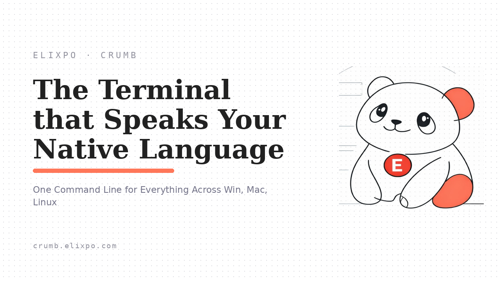

<h1 align="center">
  
  <br />
  Crumb CLI
</h1>

<p align="center">
  <strong>Your terminal, with an agent that actually gets the work done.</strong>
</p>

<p align="center">
  Ask naturally. Keep using the commands you know. Stay in control.
</p>

<p align="center">
  <a href="https://crumb.elixpo.com">Website</a> ·
  <a href="https://crumb.elixpo.com/docs">Docs</a> ·
  <a href="https://github.com/elixpo/crumb.elixpo/issues">Ideas & feedback</a>
</p>

<p align="center">
  
</p>

## Install

Linux and macOS:

```bash
curl --proto '=https' --tlsv1.2 -LsSf \
  https://raw.githubusercontent.com/elixpo/crumb.elixpo/main/install.sh | sh
```

Windows PowerShell:

```powershell
irm https://raw.githubusercontent.com/elixpo/crumb.elixpo/main/install.ps1 | iex
```

Scoop (Windows):

```powershell
scoop bucket add elixpo https://github.com/elixpo/crumb.elixpo
scoop install elixpo/crumb
```

Homebrew (macOS and Linux):

```bash
brew tap elixpo/crumb https://github.com/elixpo/crumb.elixpo
brew install elixpo/crumb/crumb
```

Debian unstable:

```bash
sudo apt install crumb
```

The Debian package is built by Debian from source against Debian's own Rust
crates, so it can trail the latest release.

The installer downloads the matching GitHub Release asset, verifies its
SHA-256 checksum, and installs `crumb` into a user-owned directory. See the
[release process](docs/development/release-process.md) for version pinning,
signature verification, supported platforms, and uninstall instructions.

## The goal

Crumb turns the terminal into a capable teammate. Tell it what you want done, let it use the tools you approve, and get a clear report when the work is finished.

It is made for people who want the speed of an AI agent without giving up the control, familiarity, or power of their own terminal.

## What you can do

- Ask Crumb to investigate, build, fix, search, or explain.
- Use normal Bash, Zsh, and PowerShell commands as usual.
- Watch commands, file edits, progress, and results while Crumb works.
- Steer, pause, cancel, or continue a task at any time.
- Keep useful context across sessions without losing sight of what is stored.
- Add skills and connect services when you need them.
- Choose how much access Crumb has—and change it whenever you want.

Try requests like:

> Find out why the tests are failing, fix the problem, and tell me what changed.

> Check whether I am signed in to GitHub and show me the current branch.

> Research this error, compare the likely fixes, and apply the safest one.

## Clear while it works

Crumb keeps the important parts visible: what it is doing, which tools it is using, how long commands take, what files changed, and how much context has been used. Detailed tool output stays out of the way until you choose to open it.

When a task runs for more than a few seconds, Crumb asks your terminal for a desktop notification once it finishes or needs your approval, so you can switch away while it works. Kitty, iTerm2, WezTerm, Ghostty and foot show a notification; other terminals get the bell. Set `CRUMB_NOTIFICATIONS=off` to turn this off.

## You stay in charge

Crumb asks before sensitive actions, keeps permissions in your hands, and shows the exact command it wants to run. You can work in planning mode, approve one action at a time, or allow broader access for a trusted workspace.

On Linux, commands Crumb runs for you are also confined by the kernel (Landlock): they can read your system, but can only write inside the project, temporary folders and toolchain caches, so your other files, such as `~/.ssh`, stay out of reach. When a command you asked for really needs to write elsewhere, Crumb asks you to approve running just that command outside the sandbox. Your own shell commands are never sandboxed. Full-access mode, or `"permissions": {"sandbox": false}`, turns this off.

If an AI service is unavailable, your terminal still works.

## Make it yours

Use model packs for different kinds of work, add focused [skills](https://crumb.elixpo.com/skills), install [plugins](https://crumb.elixpo.com/plugins), and connect outside services through [connectors](https://crumb.elixpo.com/profile/connectors).

Crumb follows your project's `AGENTS.md`, the instruction file other coding agents read too, and falls back to `CLAUDE.md`. It reads them from the repository root down to the folder you are working in, so a nested file can refine the project-wide one. These files guide how Crumb works; they never grant it permissions.

## Use it from other agents

Claude Code, Codex, and other agents can hand Crumb a whole task. In Claude Code:

```text
/plugin marketplace add elixpo/crumb.elixpo
/plugin install crumb@elixpo
```

Other agents can use the [Crumb skill and MCP server](integrations/claude-code/README.md) directly.

Programs that run Crumb as a harness can follow a turn live:

```bash
crumb exec --stream-json -- "fix the failing test in crates/api"
```

Each line on stdout is one JSON event: `started`, `text`, `reasoning`,
`tool_started`, `tool_finished`, `tool_output` (size only, never the
contents), `file_changed`, `approval_required`, `usage`, `status`,
`progress`, and finally `result`, which carries `session_id`, `response`,
`finish_reason`, and `usage`, the same fields `crumb exec --json` prints.
Errors go to stderr with a non-zero exit status, and killing the process
cancels the turn.

Continue a session with `--resume <session_id>` (the id from the `result`
event or `--json` output), and pick a configured model for one turn with
`--model <provider>/<model>`; neither changes `.crumb/agent.json`.

### In your editor (Agent Client Protocol)

`crumb acp` runs Crumb as an [Agent Client Protocol](https://agentclientprotocol.com)
agent, so editors such as Zed can use it as their coding agent. In Zed, add it
to `settings.json`:

```json
{
  "agent_servers": {
    "Crumb": {
      "type": "custom",
      "command": "crumb",
      "args": ["acp"],
      "env": {}
    }
  }
}
```

Crumb's text, reasoning and tool calls (with their output) stream into the
editor, approvals appear there as permission prompts, and sessions can be
listed and resumed. Add `--approvals always-ask|sensitive-only|full-access`
to `args` to override the workspace's approval policy. Crumb speaks ACP v1;
image and audio prompts, and MCP servers offered by the editor, are not
supported yet.

To run a turn against any OpenAI-compatible endpoint, such as a harness
runner's local relay, set `CRUMB_EXEC_BASE_URL` (and `CRUMB_EXEC_API_KEY` if
it needs a key; `CRUMB_EXEC_PROTOCOL=openai_responses` for the Responses API)
and pass `--model exec/<model-id>`. The key is read from the environment when
the request is sent and is never written to config, sessions or logs.
Whoever launches Crumb can set the turn's approval policy with
`--approvals always-ask|sensitive-only|full-access`; the model cannot change it.

## Build from source and warm-up (no keys)

<!-- Commands match .github/workflows/ci.yml (jobs "quality" and "test"). -->

You need stable Rust 1.95 or newer with clippy and rustfmt (see
[`rust-toolchain.toml`](rust-toolchain.toml)). CI runs the tests
on Linux, macOS and Windows; `scripts/test-install.sh` needs a POSIX shell
(use WSL or Git Bash on Windows). No Elixpo keys or AI provider account are
needed.

```bash
cargo fmt --all --check
cargo clippy --workspace --all-targets -- -D warnings
scripts/test-install.sh
cargo test --workspace --all-targets
```

**What works:** formatting, lints, the installer test and the full workspace
test suite. Tests use the built-in mock LLM provider, so they never call a
model. **What is skipped:** `evals/` needs a provider key and is not part of
the warm-up; the website in `crumb.elixpo/` is not needed. **Expected
result:** every command exits with status 0. If something asks you for a
secret, open an issue instead of working around it.

## Development notes

- [docs/development/mcp-boundary.md](docs/development/mcp-boundary.md)
- [docs/development/account-connector.md](docs/development/account-connector.md)
- [docs/development/provider-configuration.md](docs/development/provider-configuration.md)
- [docs/development/agent-foundation.md](docs/development/agent-foundation.md)
- [docs/development/release-process.md](docs/development/release-process.md)

## Configuration and access

This repository keeps configuration encrypted with SOPS. Applicants do not need
any keys: setup, tests and warm-up tasks run locally without decrypting
configuration. Once accepted, contributors receive SOPS access scoped to their
work (for example integration tests or staging), revoked when the programme
ends. Do not try to decrypt or commit configuration; if setup asks for a
secret, open an issue.

## License

Crumb's code is licensed under the [MIT License](LICENSE). Visual assets under
`crumb.elixpo/public/` are licensed under [CC-BY-4.0](LICENSES/preferred/CC-BY-4.0).
The Elixpo and Lumi names and marks are covered by [`TRADEMARKS.md`](TRADEMARKS.md).
## Google Summer of Code 2027

Elixpo is applying to be a mentoring organisation for Google Summer of Code 2027. Google has not announced the 2027 programme yet, and Elixpo has not been accepted. Crumb hosts one proposed project idea:

| Idea | Size | Difficulty | Mentors (primary / backup) |
| --- | --- | --- | --- |
| [Crumb connector contract and offline conformance kit](https://gsoc.elixpo.com/ideas/crumb-connector-contract/) | 175 h | Hard | [Ayushman Bhattacharya](https://github.com/Circuit-Overtime) / [Vivek Yadav](https://github.com/ez-vivek) |

**How to start**

1. Read the idea page and the programme site at [gsoc.elixpo.com](https://gsoc.elixpo.com).
2. Build Crumb from source and run the checks in [Build from source and warm-up](#build-from-source-and-warm-up-no-keys).
3. Read [Input namespaces and connectors](docs/product/input-namespaces-and-connectors.md) and the [MCP boundary](docs/development/mcp-boundary.md), plus the connector planning issues [#29](https://github.com/elixpo/crumb.elixpo/issues/29), [#30](https://github.com/elixpo/crumb.elixpo/issues/30) and [#31](https://github.com/elixpo/crumb.elixpo/issues/31).
4. Pick a small issue from the [issue tracker](https://github.com/elixpo/crumb.elixpo/issues) to learn the codebase and review process.

**Configuration and access:** no keys are needed to apply; see [Configuration and access](#configuration-and-access) above.

Questions go to **gsoc@elixpo.com**. GitHub Discussions for GSoC open once Google announces the 2027 dates.

_Google Summer of Code is a programme of Google LLC; Elixpo is applying as a mentoring organisation and is not affiliated with or endorsed by Google._

<p align="center">
  
</p>

<p align="center">
  
  Powered by <a href="https://pollinations.ai">Pollinations</a> · Built by <a href="https://elixpo.com">Elixpo</a> for people who live in the terminal.
</p>
