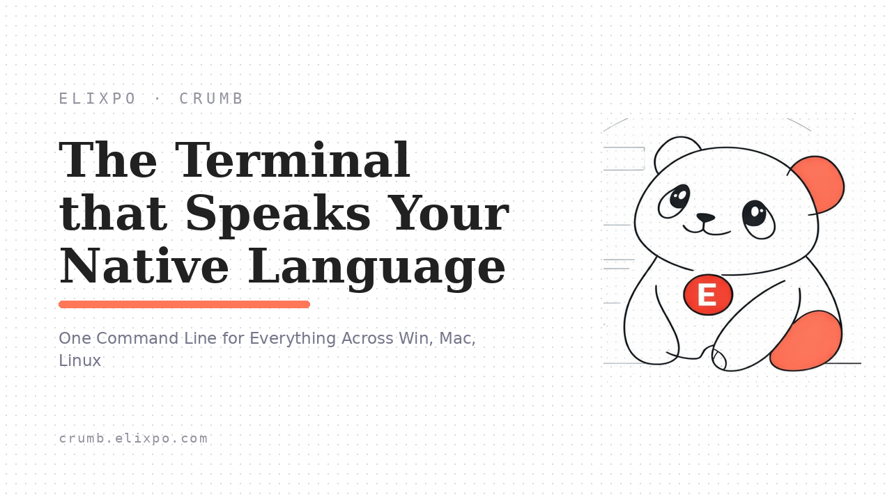

<h1 align="center">
  
  <br />
  Crumb CLI
</h1>

<p align="center">
  <strong>Your terminal, with an agent that actually gets the work done.</strong>
</p>

<p align="center">
  Ask naturally. Keep using the commands you know. Stay in control.
</p>

<p align="center">
  <a href="https://crumb.elixpo.com">Website</a> ·
  <a href="https://crumb.elixpo.com/docs">Docs</a> ·
  <a href="https://github.com/elixpo/crumb.elixpo/issues">Ideas & feedback</a>
</p>

<p align="center">
  
</p>

## Install

Linux and macOS:

```bash
curl --proto '=https' --tlsv1.2 -LsSf \
  https://raw.githubusercontent.com/elixpo/crumb.elixpo/main/install.sh | sh
```

Windows PowerShell:

```powershell
irm https://raw.githubusercontent.com/elixpo/crumb.elixpo/main/install.ps1 | iex
```

Homebrew (macOS and Linux):

```bash
brew tap elixpo/crumb https://github.com/elixpo/crumb.elixpo
brew install elixpo/crumb/crumb
```

Debian unstable:

```bash
sudo apt install crumb
```

The Debian package is built by Debian from source against Debian's own Rust
crates, so it can trail the latest release.

The installer downloads the matching GitHub Release asset, verifies its
SHA-256 checksum, and installs `crumb` into a user-owned directory. See the
[release process](docs/development/release-process.md) for version pinning,
signature verification, supported platforms, and uninstall instructions.

## The goal

Crumb turns the terminal into a capable teammate. Tell it what you want done, let it use the tools you approve, and get a clear report when the work is finished.

It is made for people who want the speed of an AI agent without giving up the control, familiarity, or power of their own terminal.

## What you can do

- Ask Crumb to investigate, build, fix, search, or explain.
- Use normal Bash, Zsh, and PowerShell commands as usual.
- Watch commands, file edits, progress, and results while Crumb works.
- Steer, pause, cancel, or continue a task at any time.
- Keep useful context across sessions without losing sight of what is stored.
- Add skills and connect services when you need them.
- Choose how much access Crumb has—and change it whenever you want.

Try requests like:

> Find out why the tests are failing, fix the problem, and tell me what changed.

> Check whether I am signed in to GitHub and show me the current branch.

> Research this error, compare the likely fixes, and apply the safest one.

## Clear while it works

Crumb keeps the important parts visible: what it is doing, which tools it is using, how long commands take, what files changed, and how much context has been used. Detailed tool output stays out of the way until you choose to open it.

## You stay in charge

Crumb asks before sensitive actions, keeps permissions in your hands, and shows the exact command it wants to run. You can work in planning mode, approve one action at a time, or allow broader access for a trusted workspace.

If an AI service is unavailable, your terminal still works.

## Make it yours

Use model packs for different kinds of work, add focused [skills](https://crumb.elixpo.com/skills), install [plugins](https://crumb.elixpo.com/plugins), and connect outside services through [connectors](https://crumb.elixpo.com/profile/connectors).

## Use it from other agents

Claude Code, Codex, and other agents can hand Crumb a whole task. In Claude Code:

```text
/plugin marketplace add elixpo/crumb.elixpo
/plugin install crumb@elixpo
```

Other agents can use the [Crumb skill and MCP server](integrations/claude-code/README.md) directly.

## Build from source and warm-up (no keys)

<!-- Commands match .github/workflows/ci.yml (jobs "quality" and "test"). -->

You need stable Rust 1.95 or newer with clippy and rustfmt (see
[`rust-toolchain.toml`](rust-toolchain.toml)). CI runs the tests
on Linux, macOS and Windows; `scripts/test-install.sh` needs a POSIX shell
(use WSL or Git Bash on Windows). No Elixpo keys or AI provider account are
needed.

```bash
cargo fmt --all --check
cargo clippy --workspace --all-targets -- -D warnings
scripts/test-install.sh
cargo test --workspace --all-targets
```

**What works:** formatting, lints, the installer test and the full workspace
test suite. Tests use the built-in mock LLM provider, so they never call a
model. **What is skipped:** `evals/` needs a provider key and is not part of
the warm-up; the website in `crumb.elixpo/` is not needed. **Expected
result:** every command exits with status 0. If something asks you for a
secret, open an issue instead of working around it.

## Development notes

- [docs/development/mcp-boundary.md](docs/development/mcp-boundary.md)
- [docs/development/account-connector.md](docs/development/account-connector.md)
- [docs/development/provider-configuration.md](docs/development/provider-configuration.md)
- [docs/development/agent-foundation.md](docs/development/agent-foundation.md)
- [docs/development/release-process.md](docs/development/release-process.md)

## Configuration and access

This repository keeps configuration encrypted with SOPS. Applicants do not need
any keys: setup, tests and warm-up tasks run locally without decrypting
configuration. Once accepted, contributors receive SOPS access scoped to their
work (for example integration tests or staging), revoked when the programme
ends. Do not try to decrypt or commit configuration; if setup asks for a
secret, open an issue.

<p align="center">
  
</p>

<p align="center">
  
  Powered by <a href="https://pollinations.ai">Pollinations</a> · Built by <a href="https://elixpo.com">Elixpo</a> for people who live in the terminal.
</p>
