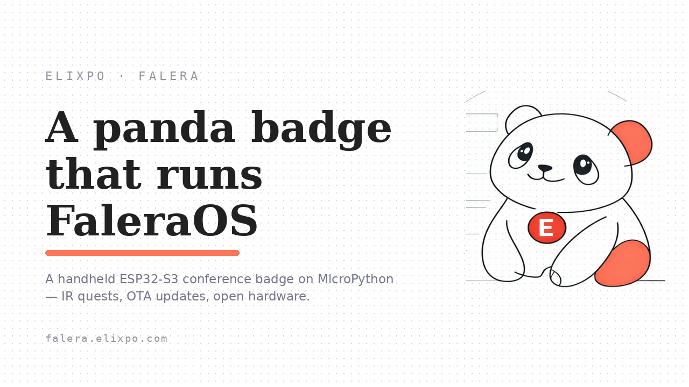
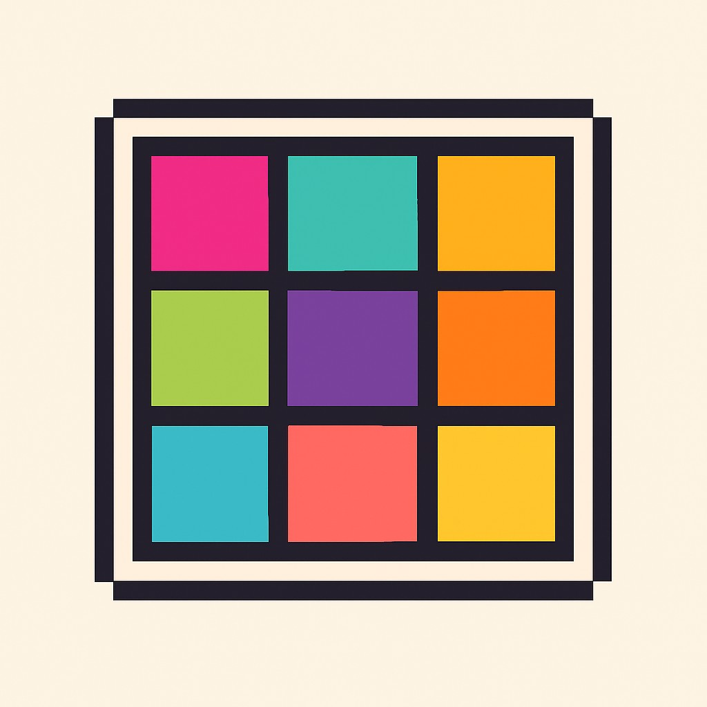
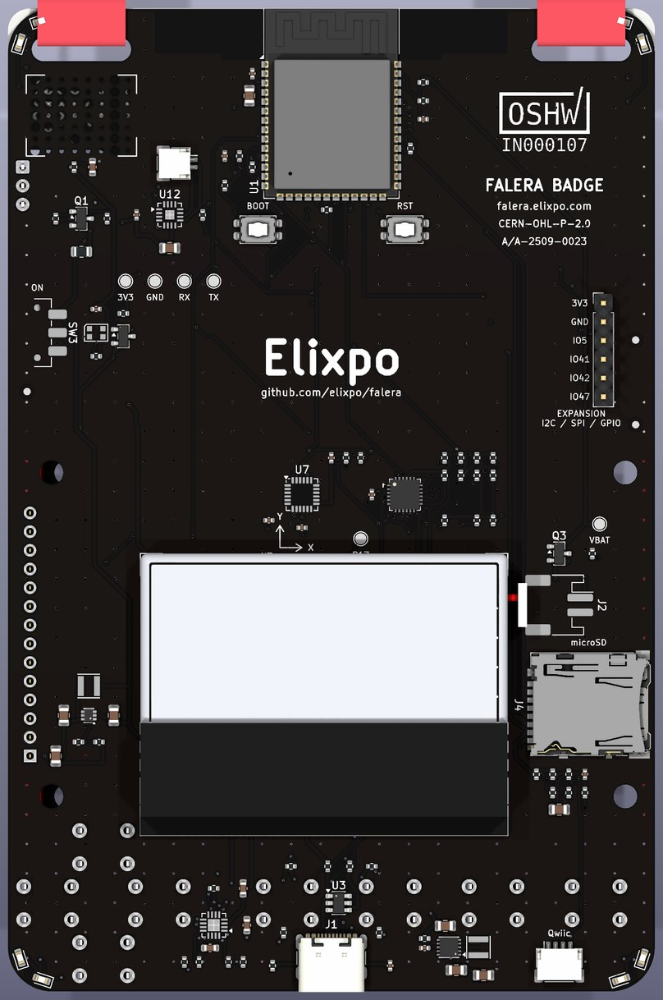

<div align="center">


# FaleraOS and the Falera Badge

**FaleraOS by Elixpo: an open-source MicroPython operating system for the Falera Badge, a panda-themed ESP32-S3 conference badge.**

*Formerly OreoOS (until November 2026). Our panda is Lumi.*

[](LICENSES/README.md)
[](https://micropython.org)
[](https://www.espressif.com/en/products/socs/esp32-s3)
[](#-updates)
[](https://payouts.elixpo.com/f/falera-badge)

[](https://www.bestpractices.dev/projects/16187)
[](https://scorecard.dev/viewer/?uri=github.com/elixpo/falera)
[](https://www.wikidata.org/wiki/Q141968869)
[](https://arxiv.org/abs/2610.35935)
[](https://certification.oshwa.org/in000107.html)
[](https://udyamregistration.gov.in/Udyam_Verify.aspx)
[](https://fossunited.org/grants/directory/elixpo)

**Featured on** [Adafruit](https://blog.adafruit.com/2026/11/04/oreoos-a-micropython-based-operating-system/) · [MA-NO](https://www.ma-no.org/en/software/operating-systems/oreoos-turns-an-esp32-s3-board-into-a-badge-with-apps-and-video) · [HardLabs](https://www.hardlabs.io/boards/elixpo--oreo) · [USB ID from Espressif](https://github.com/espressif/usb-pids/pull/425) · [more](#-in-the-press)

</div>

---

<div align="center">

> *Hang it on your lanyard. Hand it to a stranger.*
> *Swap quests over IR. Watch your commits scroll past.*
> *Falera is what happens when a conference name-tag grows up.*

</div>



<div align="center">

### 💛 Help build the first Falera badges

The first five PCBs are being made now, paid for out of pocket. If you'd like
to see Falera built, chip in whatever you can, from ₹100. Every rupee goes into
boards and parts, and everything stays open.

**[Fund the badge → payouts.elixpo.com/f/falera-badge](https://payouts.elixpo.com/f/falera-badge)**

</div>

---

<div align="center">

## 🎨 Assets by pollinations.ai

[](https://pollinations.ai)

> Every sprite, banner, and mascot of the  project &dash; Lumi, the
> badges, the in-app artwork, the website hero &dash; was generated with
> [**Pollinations.ai**](https://pollinations.ai).

</div>

---

## 🌟 At a glance

<table>
<tr>
<td width="33%" valign="top">

### 🖥 320 × 240 IPS display
A 2-inch full-colour LCD running at 33 fps with PWM-dimmed backlight. Every app you write gets the same framebuffer + theme palette.

</td>
<td width="33%" valign="top">

### 🐼 Built-in app SDK
`class App(oreoOS.App):` with three methods is all it takes. Copy [`app_templates/`](app_templates/), edit, deploy. Your icon shows up in the launcher. Guide: [`docs/APPS.md`](docs/APPS.md).

</td>
<td width="33%" valign="top">

### 📡 Real WiFi + Bluetooth
Weather, GitHub commits, OTA updates — all live. WiFi power-capped at 11 dBm so a bench supply can run it. BLE for badge-to-badge swaps.

</td>
</tr>
<tr>
<td valign="top">

### 🎮 Default apps + an App Store
GitHub tools, a markdown reader, a gallery, storage breakdown. Games, IR quests, weather and more install on-device from the App Store.

</td>
<td valign="top">

### 🔄 Over-the-air updates
The badge SHA-checks GitHub Releases in the background. Small patches install themselves. Big updates wait for your confirmation.

</td>
<td valign="top">

### 🤝 Talks to other badges
IR beacons, BLE advertise + scan, a quest system. Hand someone your badge — they hand you back a new app, a new puzzle, a new high score.

</td>
</tr>
</table>

---

## 🎮 The apps

Every tile in the drawer is its own folder under [`apps/`](apps/),
written as a small `class App(oreoOS.App)` with three lifecycle methods.
Two trees ship to the badge: [`apps/`](apps/) is what's pre-installed,
[`apps_market/`](apps_market/) is the catalogue of apps the user can
install on-device from the **App Store** tile.

<div align="center">

| | | | |
|:-:|:-:|:-:|:-:|
| <br>**Badge** | <br>**Commits** | <br>**Weather** | <br>**Racer** |
| <br>**Flappy** | <br>**Snake** | <br>**Gamepad** | <br>**Gallery** |
| <br>**IR Quest** | <br>**Reader** | <br>**Storage** | <br>**App Store** |
| <br>**Settings** | <br>**About** | | |

</div>

Bluetooth and WiFi don't get their own drawer tiles — they live inside **Settings**, alongside brightness, sleep, gestures and OTA. The notification panel (press **C** from anywhere; apps that use C themselves, like Gamepad, take a double-tap instead) puts both radios + a brightness slider + manual time-sync one tap away.

### 📦 App Store — install, update and remove apps on-device

The badge ships a small default set (About, Badge, Commits, Gallery, Gamepad, Reader, Settings, Storage, Transfer and the App Store, plus the system apps Apps, Updates and WiFi). Everything else lives under [`apps_market/`](apps_market/) and installs from the **App Store** tile: Racer, Flappy Lumi, Snake, Lumi (the panda pet), IR Quest, Bluetooth, Weather, Color, Gestures and the Diwali special, Patakha.

- **Discover** (first page): a featured card plus every app with its icon, tagline, category, size and an **INSTALL / OPEN / UPDATE** button. **A** opens the app's page (author, version, size, description) where you install it, with a progress bar.
- **Installed** (press **B**): every app on the badge. Built-in apps can only be opened; others can be updated or uninstalled behind a confirm dialog, and reinstalled from Discover any time.
- The catalogue is one file, [`apps_market/index.json`](apps_market/index.json), cached on the badge so the Store opens instantly and refreshes in the background. Apps install into the badge's filesystem, which takes all of the 16 MB flash after the firmware: about 13.7 MB.

```python
# Programmatic API (handy from the REPL):
from oreoOS import store
store.refresh()              # fetch the catalogue
store.install("racer")       # → (ok, message)
store.uninstall("racer")     # built-in apps are refused
```

**Contribute an app** by adding `apps_market/<your_app>/` with the usual `main.py + manifest.json + __init__.py + src/ + assets/` shape, then run `python3 tools/build_store_index.py` and add a tagline, description and category to its entry in `apps_market/index.json`. See [`apps_market/README.md`](apps_market/README.md).

Want yours to be **always-installed**? Drop it in `apps/` instead. Copy [`app_templates/`](app_templates/) as a starting point.

---

### Doom edition

Doom is not part of FaleraOS 2.0: dropping its 7 MB game-data partition gives the filesystem about 13.7 MB. The complete Doom build stays on the [`doom-edition`](https://github.com/elixpo/falera/tree/doom-edition) branch: the engine (doomgeneric / Chocolate Doom, GPL), the Doom app, the Freedoom tooling, the partition layout with the `doom` partition and a prebuilt firmware image. To put it on a badge (this erases it):

```bash
git fetch origin doom-edition && git switch doom-edition
./build-firmware --clean      # or use the prebuilt oreoWare/firmware/OREO_BADGE-v1.28.0.bin
./deploy --full               # firmware, Freedoom data and OS
```

## 💻 Use your badge from a computer

Plug the badge in over USB and install **falera-cli**, which gives you the
`falera` command. It finds the badge by itself, so you never need to look up a
port name.

```sh
# Linux, macOS (Windows: irm https://raw.githubusercontent.com/elixpo/falera/main/cli/install.ps1 | iex)
curl --proto '=https' --tlsv1.2 -LsSf https://raw.githubusercontent.com/elixpo/falera/main/cli/install.sh | sh

falera                                   # the full-screen Falera view
falera transfer send photo.jpg notes.md  # with Tools > Transfer open on the badge; type the code it shows
falera wifi connect "Home Net"           # Wi-Fi is for the internet: App Store, updates, GitHub, weather, time
falera update                            # newest FaleraOS, downloaded by the badge
```

- [`docs/CLI.md`](docs/CLI.md): the falera-cli manual (every command, exit
  codes, troubleshooting, FAQ); on the website at
  [falera.elixpo.com/docs/cli](https://falera.elixpo.com/docs/cli/).
- [`docs/USB.md`](docs/USB.md): ports, drivers, permissions, and raw
  `mpremote` ([/docs/usb](https://falera.elixpo.com/docs/usb/)).
- [`docs/TRANSFER.md`](docs/TRANSFER.md): how the Transfer app and its code
  exchange work ([/docs/transfer](https://falera.elixpo.com/docs/transfer/)).

## 🚀 Get going

```bash
git clone https://github.com/elixpo/falera
cd falera
python -m venv .venv && source .venv/bin/activate
pip install -r oreoOS/requirements.txt
python tools/deploy.py /dev/ttyACM0      # flash to a connected board
```

Connecting over USB (which port, the falera CLI, the Transfer app, flashing) is covered in [`docs/USB.md`](docs/USB.md).

To set your GitHub user, name, timezone and weather location, see
[`docs/PROFILE.md`](docs/PROFILE.md). For writing apps, see
[`docs/APPS.md`](docs/APPS.md); for OS internals, [`CONTRIBUTING.md`](CONTRIBUTING.md).

Host tools need Python 3.9 or newer on Linux, macOS, or Windows via WSL. The
badge itself runs MicroPython 1.28.

### Warm-up (no badge, no keys)

<!-- Command matches .github/workflows/tests.yml (Python 3.11, standard library only). -->

```bash
git clone https://github.com/elixpo/falera
cd falera
python3 -m unittest discover -s tests -v
```

**What works:** the hardware-free unit tests for pure helpers (colour packing in
`oreoOS/api.py`, `.env` parsing in `oreoOS/config.py`). They use only the
Python standard library, so no `pip install`, badge or key is needed.
**What is skipped:** running FaleraOS apps needs an ESP32-S3 badge; there is no
desktop simulator yet. With a badge, `tools/deploy.py` runs without keys and writes blank
WiFi and weather values when `.env.local` is missing. **Expected result:**
`OK` at the end of the run. If something asks you for a secret, open an issue
instead of working around it.

### Configuration and access

This repository keeps configuration encrypted with SOPS. Applicants do not need
any keys: setup, tests and warm-up tasks run locally without decrypting
configuration. Once accepted, contributors receive SOPS access scoped to their
work (for example integration tests or staging), revoked when the programme
ends. Do not try to decrypt or commit configuration; if setup asks for a
secret, open an issue.

---

## 🔔 The notification panel

Press **C** from any app. A pink panel slides down with everything you'd otherwise dig through menus for:

| Row | What it does |
|---|---|
| WiFi · BT · Settings | three pills — A toggles the radio, or jumps straight to the Settings app |
| Brightness slider | LEFT / RIGHT nudges the LCD backlight by 10 %, no preset cycling |
| Sync time | A re-runs the NTP sync — useful when WiFi just came up or you crossed a timezone |
| Notification cards | newest-first list of OTA / BT / file events; A opens, B clears all |

Press **C** (or **HOME**) again to dismiss — the underlying app keeps its state and resumes mid-frame.

---

## 🧰 Built-in libraries

FaleraOS ships a small batteries-included SDK that every app imports
from `oreoOS`. Three of those are worth a quick tour:

### Drawing — `d.rect`, `d.pixel`, `d.text`, `d.blit`, `d.clear`

```python
from oreoOS import api, theme

def draw(self, d):
    d.clear(theme.BG)                            # fill cream background
    d.rect(10, 10, 100, 40, theme.PRIMARY, fill=True)
    d.rect(10, 10, 100, 40, theme.GOLD)          # outline (fill=False default)
    d.pixel(60, 30, api.WHITE)                   # single pixel
    d.text("hello!", 14, 20, api.WHITE, scale=2) # framebuf 8×8, scaled
    d.text(api.rgb(160, 50, 220), 14, 60, ...)   # arbitrary RGB
```

The framebuffer is RGB565 big-endian. Build colours with `api.rgb(r, g, b)`
instead of constructing the integer by hand. Theme colours
(`theme.PRIMARY` / `theme.GOLD` / `theme.TEAL` / `theme.MUTED` / …)
exist for visual consistency across apps.

### Sprites + images — `d.blit`

```python
def _try_sprite(name):
    try:
        m = __import__("apps.my_app.assets.optimized." + name, None, None,
                       ["DATA", "W", "H"])
        return (bytearray(m.DATA), m.W, m.H)
    except (ImportError, AttributeError):
        return None

def draw(self, d):
    if (s := self._sprite):
        data, w, h = s
        d.blit(data, x, y, w, h)
```

Sprites are produced by `tools/optimize_assets.py` from raw PNG / JPG
files under `apps/my_app/assets/raw/`. Pixels equal to chroma-key
magenta (`0xF81F` RGB565) are skipped by `blit()` — that's how the
panda mascot ends up with a transparent backdrop on the splash.

### Higher-level text — `oreoOS.pixelfont`

```python
from oreoOS import pixelfont
font = pixelfont.load("pixelify_16")  # also pixelify_8, _12, _24
font.text(d, "Score: 42", 8, 6, theme.PRIMARY)
w = font.measure("Score: 42")          # for centring
```

The framebuf's 8×8 font is fine for HUDs; the Pixelify Sans bitmaps
look better for titles and menus.

### Caching network data — `oreoOS.cache`

```python
from oreoOS import cache
profile, age = cache.load("apps/my_app/cache.txt", ttl_s=3600)
if not profile or age > 3600:
    profile = my_fetch_function()
    cache.save("apps/my_app/cache.txt", profile)
```

Used by Badge + Commits to render instantly from disk and refresh in
the background. Auto-includes a `__ts=<epoch>` header so callers know
the cache age.

### Time + NTP sync — `oreoOS.timeutil`

```python
from oreoOS import timeutil
hour, minute, sec, weekday, day, month, year = timeutil.now()

ok, msg = timeutil.sync_from_ntp()        # ~2 s blocking, gated on WiFi
print(timeutil.last_sync_status())        # "ok" | "no-wifi" | "failed" | "never"
```

Same call drives the boot-time auto-sync, the **Sync Time** row in
Settings, and the **C-panel** time-sync action — all three surfaces
agree on the last result via the shared `last_sync_status()`.

### Storage breakdown — `oreoOS.storage`

```python
from oreoOS import storage
snap = storage.usage()
# {'stats': {'total': …, 'used': …, 'free': …},
#  'buckets': {'system': {...}, 'apps': {...}, 'gallery': {...},
#              'documents': {...}, 'misc': {...}}}
```

A full `os.listdir + os.stat` walk takes a few hundred ms on a
populated 16 MB flash, so the Storage app declares
`SHOW_LOADING = True` to mask the blocking call behind the slide
splash. Use it from any app that wants a "how full am I?" readout.

### Markdown rendering — the Reader app

The Reader app (`apps/reader/`) renders **`.md`** and **`.txt`** files
copied to `documents/` over USB or flashed into `apps/reader/assets/`.
Supports `# / ## / ###` headings, `**bold**`, `*italic*`, `` `code` ``,
bullets, numbered lists, fenced ``` ``` ``` blocks, and `---` rules —
small enough to ship to flash, big enough for README-style notes. New files appear in the picker within
200 ms (5 Hz poll) — no restart.

### Wireless networking and Bluetooth

FaleraOS leans on MicroPython's stock networking stack; the FaleraOS
wrappers (`oreoWare.wifi`, `oreoWare.bt`) add config handling and
power capping on top.

- **WiFi** — [`network.WLAN`](https://docs.micropython.org/en/latest/library/network.WLAN.html).
  Wi-Fi is for the internet only (App Store, updates, GitHub data,
  weather, the clock). Networks are added over USB with the `falera` CLI
  (see [`docs/CLI.md`](docs/CLI.md)) or at deploy time from `.env.local`
  (`WIFI_SSID`, `WIFI_PASSWORD`; see [`.env.example`](.env.example)); the OS
  applies `wlan.config(txpower=…)` and `pm=PM_POWERSAVE` from
  `oreoOS/config.py` so a sealed badge doesn't melt its LDO.
- **Bluetooth** — [`bluetooth`](https://docs.micropython.org/en/latest/library/bluetooth.html).
  Bluetooth is the last feature on the roadmap (#124); files go over USB
  for now. The current build advertises as **Falera** and exposes a tiny GATT "transfer"
  service so a paired device can push **one image (max 250 KB)** or
  **one text document (deflate-compressed)** at a time. Images land in
  `apps/gallery/assets/raw/`, text in `documents/`. BLE adv interval is
  capped by `BT_ADV_INTERVAL_MS` to keep average current draw down.

```python
# WiFi via the FaleraOS wrapper — auto-applies power caps from config
from oreoWare import wifi
wifi.connect_from_config()
print(wifi.ip())

# Or drop straight to stock MicroPython:
import network
wlan = network.WLAN(network.STA_IF)
wlan.active(True)
wlan.connect("SSID", "password")
```

```python
# BLE advertise (raw stdlib path)
import bluetooth
ble = bluetooth.BLE()
ble.active(True)
ble.gap_advertise(500_000, b"\x02\x01\x06\x05\x09Oreo")
```

**Pushing files to the badge.** Connect to "Falera", then write to the
RX characteristic in chunks. Frame format:

```
+------+-------------------+-----------+-------------+
| type | length (4B BE)    | payload   | crc32 (4B)  |
+------+-------------------+-----------+-------------+
  'I'  =  image,    raw bytes, length ≤ 250 KB
  'T'  =  text,     deflate-compressed UTF-8 → documents/*.txt
  'M'  =  markdown, deflate-compressed UTF-8 → documents/*.md
```

The TX characteristic notifies a single-byte status (`0x02` = done,
`0xE1` = too large, `0xE2` = bad CRC, …). See [`oreoWare/bt.py`](oreoWare/bt.py)
for the full UUID + status table.

### Built-in modules

Every stock MicroPython module is available to apps — no extra install
step. The ones you'll actually reach for on badge work:

`array`, `binascii`, `builtins`, `cmath`, `collections`, `errno`, `gc`,
`hashlib`, `heapq`, `io`, `json`, `machine`, `math`, `micropython`,
`network`, `os`, `platform`, `random`, `re`, `select`, `socket`, `ssl`,
`struct`, `sys`, `time`, `uctypes`, `bluetooth`, `cryptolib`, `deflate`,
`framebuf`, `vfs`, `ntptime`, `requests`, `urequests`, `asyncio`,
`aioble`, `websocket`, `umqtt`, `webrepl`.

On top of those, FaleraOS ships its own helper packages: `oreoOS.*`
(font, sprite, cache, theme, widgets, ota, power…) and `oreoWare.*`
(display, buttons, wifi, bt, imu, ir, battery, pins). Import them from
any app — they're on the device boot path.

---

## 🖼 Gallery — flashing your own photos

The Gallery app cycles through pictures you ship with the badge.
Workflow:

```bash
# 1. Drop pictures into apps/gallery/assets/raw/
cp ~/Pictures/team-offsite.jpg apps/gallery/assets/raw/

# 2. Bake them to RGB565 (preserves aspect ratio, fits 320×196 play area)
python tools/optimize_assets.py --app gallery

# 3. Push to the badge — the deploy step also prunes any stale photos
#    the user deleted from raw/ so the device stays in sync.
python tools/deploy.py /dev/ttyACM0
```

The optimizer accepts `.png`, `.jpg`, and `.jpeg`. Photos are
aspect-preserved (no forced square crop). On the badge, **L/R cycles
photos**, and the last tile is a **+ help screen** that walks any
user through this exact workflow.

---

## 🛠 Hardware

FaleraOS runs today on a breadboard badge built from an ESP32-S3 DevKitC. The
PCB badge, designed in KiCad under [`circuit/elixpo/`](circuit/elixpo/), is
finished: the first five boards were ordered in November 2026, and FaleraOS is
flashed onto it once a board is assembled.

<div align="center">


</div>

| | Breadboard badge (runs today) | PCB badge (first boards ordered) |
|---|---|---|
| **MCU** | ESP32-S3-DevKitC-1-N16R8 | ESP32-S3-WROOM-1-N16R8 (16 MB flash, 8 MB PSRAM) |
| **Display** | ST7789 IPS, 2.0", 320×240 | ILI9341 2.8", 320×240, resistive touch, on its own 5 V boost |
| **Input** | 8 buttons on GPIOs | 8 buttons on an AW9523B I²C expander, plus RESET and BOOT |
| **Sensors** | MPU-6050, TSOP38238 IR receiver | MPU-6050 (I²C 0x69), TSOP38238 IR receiver |
| **Output** | 4 corner LEDs, WS2812 status LED, IR LED | 4 corner LEDs (each with 2 more on the back edge), WS2812B status LED, IR LED, MAX98357A amp and speaker |
| **Storage** | — | microSD (1-bit SDMMC) |
| **Expansion** | — | Qwiic (I²C) and a 4-GPIO header (I²C, SPI or GPIO) |
| **Comms** | Wi-Fi, BLE 5.0, IR, USB-C | Wi-Fi, BLE 5.0, IR, native USB-C |
| **Power** | 18650 + MAX17048, AMS1117-3.3 | LiPo with BQ24074 USB-C charger, TPS63031 3.3 V buck-boost |
| **Clock** | RTC backed by NTP | ESP32 clock, set by NTP after a cold start |
| **Board** | — | 4 layers, 88 × 133.5 mm, OSHWA-certified (IN000107) |

The PCB's design notes, pin map and ordering steps are in
[`circuit/elixpo/README.md`](circuit/elixpo/README.md), and the parts and cost
of one badge in [`circuit/elixpo/BOM_COST.md`](circuit/elixpo/BOM_COST.md).

📄 **Full electrical / mechanical specs:** see [`docs/DATASHEET.md`](docs/DATASHEET.md)
🔧 **Build guide + pinout + soldering tips:** see [`docs/HARDWARE.md`](docs/HARDWARE.md)

The single source of truth for every GPIO assignment is
[`oreoWare/pins.py`](oreoWare/pins.py) — one file, one line per pin.

---

## 🔄 Updates

The badge pulls itself forward. A fast SHA-vs-version check runs in the background against the project's GitHub release channel. **Small patches** (≤ 80 KB) install themselves; **big updates** wait for your explicit yes. Files are validated by SHA-256 and atomically swapped on the next boot — if anything goes wrong mid-download, the badge keeps running its old version.

Every HTTPS connection **verifies the server's certificate** (chain, host name and dates) against a small bundle of root CAs shipped with the OS, so a network attacker cannot fake an update or an App Store download. Verification needs the real date, so the badge syncs its clock over NTP before the first secure request; if the certificate or the clock can't be checked, the Updates and App Store screens say so (`TLS: ...`) instead of connecting anyway. Hosts, roots and fingerprints: [`docs/TLS.md`](docs/TLS.md).

Wall-clock time follows the same pattern: NTP runs once at boot when WiFi is up, and the **Sync Time** action (Settings or the C-panel) lets you re-pull if you crossed a timezone or the clock drifted.

Cutting a release takes one command: `python tools/release.py`. Details in [`CONTRIBUTING.md → Releasing`](CONTRIBUTING.md#releasing).

---

## 🎞 RV565 — the badge's video format, for any project

The Gallery's video playback grew into **RV565**, a standalone library and file format for smooth video on ESP32 SPI displays (24 FPS with zero missed frames on the ESP32-S3; [arXiv:2610.35935](https://arxiv.org/abs/2610.35935)). It lives in its own repository, [elixpo/rv565](https://github.com/elixpo/rv565), and installs from the official channels:

| Where | How |
|---|---|
| Arduino | Library Manager → **RV565**, or `arduino-cli lib install RV565` |
| Python (desktop) | `pip install rv565` — [on PyPI](https://pypi.org/project/rv565/), with a Pillow plugin via `pip install "rv565[pillow]"` |
| ESP-IDF | `idf.py add-dependency "elixpo/rv565"` — [ESP Component Registry](https://components.espressif.com/components/elixpo/rv565) |
| CircuitPython | `circup install circuitpython_rv565` — [elixpo/CircuitPython_RV565](https://github.com/elixpo/CircuitPython_RV565), [docs](https://circuitpython-rv565.readthedocs.io) |
| Browser | [falera.elixpo.com/rv565/convert](https://falera.elixpo.com/rv565/convert/) — convert a video with no install and no upload |

---

## 📚 Reading order

| | |
|---|---|
| 👋 **Just want to use it?** | this README + [`docs/HARDWARE.md`](docs/HARDWARE.md) |
| 🔌 **Connecting it to a computer?** | [`docs/USB.md`](docs/USB.md) + [`docs/CLI.md`](docs/CLI.md): the falera CLI, Transfer, flashing |
| 🧑‍💻 **Want to write an app?** | [`docs/APPS.md`](docs/APPS.md) + [`app_templates/`](app_templates/) |
| 🔌 **Building your own PCB?** | [`docs/DATASHEET.md`](docs/DATASHEET.md) + [`oreoWare/pins.py`](oreoWare/pins.py) |
| 🤝 **Joining the community?** | [`CODE_OF_CONDUCT.md`](CODE_OF_CONDUCT.md) + [`SUPPORT.md`](SUPPORT.md) |
| 🛡 **Found a vulnerability?** | [`docs/SECURITY.md`](docs/SECURITY.md) |
| 📖 **Citing FaleraOS or RV565?** | [`CITATION.cff`](CITATION.cff) + [`paper/`](paper/) |

A docs index lives at [`docs/README.md`](docs/README.md).

---

## 🙌 Contributing

We love new contributors. The bar is low; the welcome is warm.

- 🐛 Bugs / ideas: open an [issue](https://github.com/elixpo/falera/issues/new/choose)
- 🔧 Code: read [`CONTRIBUTING.md`](CONTRIBUTING.md)
- 🧑‍🤝‍🧑 Community: read the [`Code of Conduct`](CODE_OF_CONDUCT.md)
- 🔐 Security disclosures: read [`docs/SECURITY.md`](docs/SECURITY.md)

---

## The Falera family

One project in three repositories, grouped under the
[`oreo-badge`](https://github.com/orgs/elixpo/repositories?q=topic%3Aoreo-badge) topic:

- [elixpo/falera](https://github.com/elixpo/falera): the Falera Badge hardware, FaleraOS and the `falera` CLI
- [elixpo/rv565](https://github.com/elixpo/rv565): RV565, the badge's video format (C library, encoder, Arduino, ESP-IDF and Pico SDK)
- [elixpo/CircuitPython_RV565](https://github.com/elixpo/CircuitPython_RV565): RV565 playback for CircuitPython

---

## The ecosystem

Falera Badge is part of **Elixpo** - an open, ethical, and accessible ecosystem
of AI and developer tools, built by a global community of 45+ contributors.

| Tool | What it does | Link |
| --- | --- | --- |
| 🎨 **Elixpo Art** | AI image generation _(under dev)_ | [art.elixpo.com](https://elixpo.com) |
| ✍️ **Elixpo Blogs** | A rich, modern writing and publishing space | [blogs.elixpo.com](https://blogs.elixpo.com) |
| 🖊️ **LixSketch** | A hand-drawn style whiteboard for ideas and diagrams | [sketch.elixpo.com](https://sketch.elixpo.com) |
| 💬 **Elixpo Chat** | A fluid, real-time AI chat experience _(under dev)_ | [chat.elixpo.com](https://chat.elixpo.com) |
| 🔎 **Elixpo Search** | Fast, AI-assisted search | [search.elixpo.com](https://search.elixpo.com) |
| 👤 **Elixpo Accounts** | One identity (SSO) across the ecosystem | [accounts.elixpo.com](https://accounts.elixpo.com) |
| 🔗 **lixrl** | Our flagship URL shortener | [lixrl.com](https://lixrl.com) |
| 🪪 **Portfolios** | Personal pages to showcase your work | [me.elixpo.com](https://me.elixpo.com) |
| 🐼 **Lumi** | The mascot's home | [falera.elixpo.com](https://falera.elixpo.com) |

## Built by the community

Elixpo is made by people, in the open. **45+ contributors** have shaped these
tools, with a small core team steering the way:

- **Ayushman Bhattacharya** - Founder & Lead ([@Circuit-Overtime](https://github.com/Circuit-Overtime))
- **Vivek Yadav** - Lead Co-Dev ([@ez-vivek](https://github.com/ez-vivek))
- **Anwesha Chakraborty** - Core Maintainer ([@anwe-ch](https://github.com/anwe-ch))

Everyone is welcome. See **[CONTRIBUTING.md](CONTRIBUTING.md)** and our
**[Code of Conduct](CODE_OF_CONDUCT.md)**.

## 📰 In the press

**Coverage**

- **Adafruit**, 4 November 2026: [OreoOS, a MicroPython-based operating system](https://blog.adafruit.com/2026/11/04/oreoos-a-micropython-based-operating-system/)
- **MA-NO**, 4 November 2026: [OreoOS turns an ESP32-S3 board into a badge with apps and video](https://www.ma-no.org/en/software/operating-systems/oreoos-turns-an-esp32-s3-board-into-a-badge-with-apps-and-video)
- **Adafruit**, 10 November 2026: [RV565, frame-independent RGB565 video for ESP32-S3 and RP2350 SPI displays](https://blog.adafruit.com/2026/11/10/rv565-frame-independent-rgb565-video-for-esp32-s3-and-rp2350-spi-displays/)
- **HardLabs**: [Oreo by elixpo, open source PCB, KiCad files and BOM](https://www.hardlabs.io/boards/elixpo--oreo)

**Recognised upstream**

- **Espressif** assigned the badge its own USB ID, `303a:83ec` "Elixpo Falera Badge" ([espressif/usb-pids#425](https://github.com/espressif/usb-pids/pull/425), 10 November 2026).
- **OSHWA** certified the badge as open source hardware, [UID IN000107](https://certification.oshwa.org/in000107.html).
- **The Unix `file` command** recognises RV565 videos: the magic was committed upstream on 12 November 2026 ([file bug 822](https://bugs.astron.com/view.php?id=822)).
- **Adafruit's CircuitPython Community Bundle** ships the RV565 library, so `circup install circuitpython_rv565` works ([CircuitPython_Community_Bundle#292](https://github.com/adafruit/CircuitPython_Community_Bundle/pull/292), 11 November 2026).
- **Arduino_GFX**, the Arduino display library, includes an RV565 video example ([Arduino_GFX#823](https://github.com/moononournation/Arduino_GFX/pull/823), 14 November 2026).
- **Awesome lists**: RV565 is listed in [Awesome CircuitPython](https://github.com/adafruit/awesome-circuitpython/pull/63) and [Awesome Raspberry Pi](https://github.com/thibmaek/awesome-raspberry-pi/pull/371).

**Published**

- **Paper**: [RV565: Cross-Layer Co-Design for Frame-Independent Video Playback on MicroPython-Class ESP32-S3 Systems](https://arxiv.org/abs/2610.35935), arXiv:2610.35935.
- **RV565 library**: [Arduino Library Manager](https://www.arduinolibraries.info/libraries/rv565), [Espressif component registry](https://components.espressif.com/components/elixpo/rv565), [PyPI](https://pypi.org/project/rv565/), [CircuitPython](https://github.com/elixpo/CircuitPython_RV565).
- **Wikidata**: FaleraOS is [Q141968869](https://www.wikidata.org/wiki/Q141968869).
- **MicroPython community**: [FaleraOS announcement](https://github.com/orgs/micropython/discussions/19847).

> FaleraOS is an open-source MicroPython operating system for the Elixpo Falera Badge. It is not
> related to Android 8.0 Oreo or to OREO® cookies, a trademark of Mondelēz International.

## Recognition & programs

Elixpo has taken part in and been supported by **GSSOC**, **Hacktoberfest**,
**Pollinations.AI**, **MS Startup Foundations**, and **OSCI**.

FaleraOS is recorded on Wikidata as
[FaleraOS (Q141968869)](https://www.wikidata.org/wiki/Q141968869), an embedded
operating system based on MicroPython. Its video pipeline is described in the
paper [RV565 (arXiv:2610.35935)](https://arxiv.org/abs/2610.35935), and the
playback library is published separately as
[RV565](https://github.com/elixpo/rv565) (Arduino Library Manager, ESP Component
Registry, PyPI, CircuitPython).

**Written about**

- Adafruit blog: [RV565: frame-independent RGB565 video for ESP32-S3 and RP2350 SPI displays](https://blog.adafruit.com/2026/11/10/rv565-frame-independent-rgb565-video-for-esp32-s3-and-rp2350-spi-displays/) (10 Nov 2026)
- Elixpo blog: [From 0.5 FPS to native video: building FaleraOS Gallery playback](https://blogs.elixpo.com/elixpohere/esp32s3-spiderman)
- Elixpo blog: [The Screen Was Blank](https://blogs.elixpo.com/elixpohere/rv565-pico-2-tweak), porting RV565 to the Raspberry Pi Pico 2
- Paper: [arXiv:2610.35935](https://arxiv.org/abs/2610.35935), archived on [Zenodo](https://doi.org/10.5281/zenodo.23543367)

**Submitted, under review**

- The board image for MicroPython's board list: [micropython-media #132](https://github.com/micropython/micropython-media/pull/132)
- FaleraOS in [awesome-esp #68](https://github.com/agucova/awesome-esp/pull/68)
- RV565's own submissions (FFmpeg, file(1), PRONOM, Kaitai and others) are
  listed in [its README](https://github.com/elixpo/rv565#where-rv565-is).

### Google Summer of Code 2027

Elixpo is applying to be a mentoring organisation for Google Summer of Code
2027. Google has not announced the 2027 programme yet, and Elixpo has not been
accepted. Falera hosts one proposed project idea:

| Idea | Size | Difficulty | Mentors (primary / backup) |
| --- | --- | --- | --- |
| [Falera badge simulator and CLI test bench](https://gsoc.elixpo.com/ideas/oreo-badge-simulator/) | 175 h | Intermediate | [Ayushman Bhattacharya](https://github.com/Circuit-Overtime) / [Vivek Yadav](https://github.com/ez-vivek) |

**How to start** (no badge hardware needed)

1. Read the idea page and the programme site at [gsoc.elixpo.com](https://gsoc.elixpo.com).
2. Run the tests (`python3 -m unittest discover -s tests` and
   `python3 tools/validate_app.py`, standard library only), install the CLI
   from the checkout (`pip install -e cli/`) and try `falera new my_app`. Read
   [docs/LEARN.md](docs/LEARN.md) for a guided tour of FaleraOS.
3. Read [`docs/CLI.md`](docs/CLI.md), [`docs/README.md`](docs/README.md) and
   [`docs/HARDWARE.md`](docs/HARDWARE.md): the simulator stands in for the
   display and buttons, and answers the `falera` CLI like a badge.
4. Read [CONTRIBUTING.md](CONTRIBUTING.md), then pick a small issue from the
   [issue tracker](https://github.com/elixpo/falera/issues).

**Configuration and access**

This repository keeps configuration encrypted with SOPS. Applicants do not need
any keys: the warm-up tasks and the core of the idea run locally without
decrypting configuration. Once accepted, contributors receive SOPS access
scoped to their project (for example for integration tests or staging), which
is revoked when the programme ends.

Questions go to **gsoc@elixpo.com**. GitHub Discussions for GSoC open once
Google announces the 2027 dates.

_Google Summer of Code is a programme of Google LLC; Elixpo is applying as a
mentoring organisation and is not affiliated with or endorsed by Google._

## Get involved

- 💬 **Join the conversation** in [GitHub Discussions](https://github.com/orgs/elixpo/discussions).
- 🚀 **Submit your project** to be featured across the ecosystem.
- 🛠️ **Contribute** - browse good first issues in the [monorepo](https://github.com/elixpo/elixpo_chapter).

## Brand assets

The Lumi mascot, badge sprites, and app icons live under
[`assets/`](assets/). They are CC-BY-4.0, but the Lumi mascot, the chest
E-badge, and the "Elixpo"/"Falera" names are trademarks - see
[`TRADEMARKS.md`](TRADEMARKS.md). A browsable
brand kit is at **[elixpo.com/assets](https://elixpo.com/assets)**.

## License

The Falera Badge is **certified open source hardware** by the Open Source
Hardware Association, UID [IN000107](https://certification.oshwa.org/in000107.html).

<a href="https://certification.oshwa.org/in000107.html">
  <picture>
    <source media="(prefers-color-scheme: dark)" srcset="falera.elixpo/public/oshw_mark_card.png">
    
  </picture>
</a>

> **Dedication.** FaleraOS is dedicated to [@anwe-ch](https://github.com/anwe-ch),
> for its full runtime. Read why in the [preamble](PREAMBLE.md).
>
> _Psst: she is the co-author of [RV565](https://arxiv.org/abs/2610.35935),
> the video format the Gallery plays._

- **Code** (FaleraOS, oreoWare, apps, tooling) - [MIT](LICENSE).
- **Hardware** (KiCad schematics, PCB, symbols, BOMs and generated files under
  [`circuit/`](circuit/)) -
  [CERN-OHL-P-2.0](LICENSES/preferred/CERN-OHL-P-2.0), the permissive CERN Open
  Hardware Licence.
- **Brand & visual assets** (mascot, sprites, icons) -
  [CC-BY-4.0](LICENSES/preferred/CC-BY-4.0).
- **Upstream firmware components** - the firmware image incorporates
  MicroPython (MIT) and Espressif ESP-IDF
  ([Apache-2.0](LICENSES/preferred/Apache-2.0)); downstream distributors of
  compiled firmware must retain those licenses. See
  [`LICENSES/notices/notice-board`](LICENSES/notices/notice-board).

The Lumi mascot, the chest E-badge, the "Elixpo", "Falera", "Falera Badge", and
"FaleraOS" names, and the elixpo.com domains are trademarks of the Elixpo project
and are not licensed by MIT, CERN-OHL-P-2.0 or CC-BY-4.0. See [`TRADEMARKS.md`](TRADEMARKS.md)
and the per-product notice board, [`LICENSES/NOTICE`](LICENSES/NOTICE).

## Exclusive

This repository ships firmware and hardware. The files are open (MIT,
CERN-OHL-P-2.0, CC-BY-4.0); what Elixpo reserves is identity, not the design
(full text in [`LICENSES/NOTICE`](LICENSES/NOTICE)):

- The **`faleraos`** and **`oreoos`** published package names.
- The official **firmware / OTA release bundles** distributed from GitHub
  Releases and the "Falera" OTA identity.
- The **Falera Badge name and look**: the "Falera Badge" product name, the panda
  mascot and the chest E-badge.

You may build, modify, sell and redistribute boards and firmware made from the
open design files - just not under the reserved Elixpo / Falera names or mascot.

---

<div align="center">


With 💖 by [**Ayushman Bhattacharya**](https://github.com/Circuit-Overtime).

Want to help, ship an app, sponsor a build, or just say hi - ✉️ **hello@elixpo.com**

</div>
