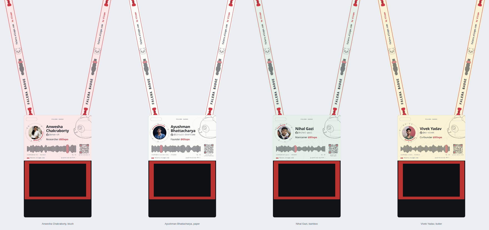
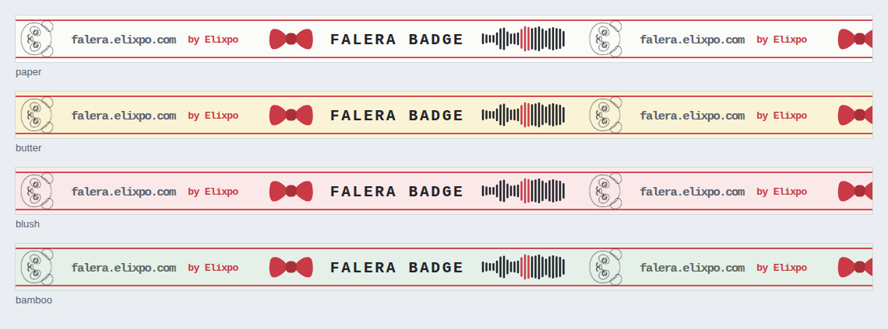

# Lanyard

The Falera Badge lanyard: a 12 mm strap through both lanyard slots, printed on
one side in the name card's ink and red.

## Themes

The strap matches the card: a faint ground from the Elixpo palette
(`falera.elixpo/src/app/globals.css`), with the card's ink (#1f2328) text, red
(#c93a45) bow, wave peaks, edge stripes and folded ends.

| Theme | Strap | From |
| --- | --- | --- |
| `paper` | #fbfbf8 | the site's paper |
| `butter` | #fbf3d6 | a faint yellow |
| `blush` | #fbe9ea | the red, faint (the site's red tint) |
| `bamboo` | #e5f0e8 | the green, faint (the site's green tint) |

Each person's lanyard is in their card's theme (`"theme"` in
`name-card/people.json`); `make_lanyard.py` prints how many straps of each
theme to order. Add or change a theme in `THEMES`
in `make_lanyard.py`.

| File | What |
| --- | --- |
| `lanyard-print-<theme>.svg` | the artwork, 950 × 12 mm, for the printer |
| `renders/lanyard-print-<theme>.pdf` | the same as a PDF at 950 × 12 mm (fonts embedded) |
| `renders/preview-<handle>.png` | each person's card on the badge, with the lanyard in their card's theme |
| `renders/themes.png` | all the themes, stacked |
| `renders/previews.png` | everyone, side by side |
| `lanyard-guides.svg` | the artwork with the fold, sew and centre lines marked |
| `make_lanyard.py` | regenerates all of these |

Run `python3 make_lanyard.py` (needs a headless Chromium, as for
`name-card/make_cards.py`, and `pdftoppm`).

## Dimensions

| | mm | Why |
| --- | ---: | --- |
| Strap width | 12 | the badge's slots are 13.6 × 3.3 mm: 12 mm leaves 0.8 mm a side, and the folded strap (two layers) passes the 3.3 mm height |
| Printed length | 950 | 900 mm shows, around the neck |
| Fold, each end | 25 | goes through a slot and back (red, no pattern) |
| Sew line | 12 from each end | stitch the fold shut here |
| Artwork clear of the long edges | 1.2 | for sublimation registration; the red edge stripes sit on this line |

Strap material: polyester for dye sublimation, about 1 mm thick or less, so the
fold fits the slot. Check a sample through a real board's slot before ordering.

## The pattern

One 138.5 mm module, three times on each half, spaced evenly:
the bow, **FALERA BADGE**, a piece of the waveform, Lumi (facing the viewer, upright when worn;
`assets/lumi-front.png`, from `circuit/elixpo/art/lumi-front-lineart.png`), `falera.elixpo.com`
and "by Elixpo". The waveform pieces are consecutive slices of one sequence
(SHA-256 of `falera:<n>`, smoothed like the card's), so they read as one band
broken by the text; each piece's peak is red.

The second half is the first turned 180° about the centre, with a bow on the
centre line at the neck, alone in a 24 mm clear zone. Worn, both sides read the same way, from the badge
up.
