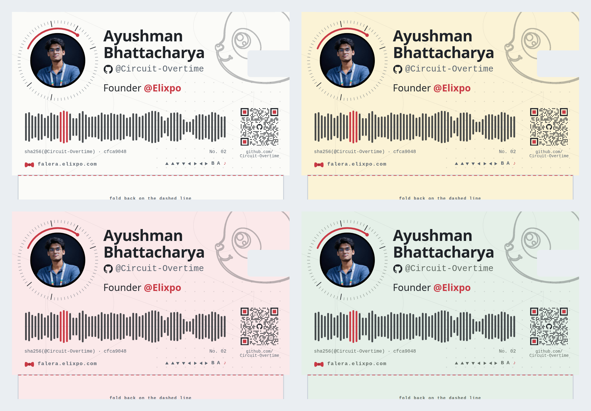

# Name cards

One printed name card per person, for the front of the Falera Badge, and the
template they are cut to.

| Path | What |
| --- | --- |
| `people.json` | who gets a card: GitHub handle, name, role, org, photo |
| `make_cards.py` | builds `cards/<handle>.html` for everyone in `people.json`; `--render` also writes each card's PNG and PDF (needs `pip install qrcode`, and a headless Chromium for `--render`) |
| `make_sheet.py` | lays the cards in `cards/` out six to an A4 page, `renders/sheet-N.pdf` (vector, crop marks, spare places as empty outlines; needs `pip install pypdf`) |
| `card.css` | the shared card style, in real millimetres |
| `cards/` | one card per page: open in a browser to preview, print at 100% on A4 to cut |
| `renders/` | each card's PNG preview and print PDF, and each sheet's PNG and PDF |
| `assets/` | photos, the bow, and Lumi's line art (`lumi-line.png`, `circuit/elixpo/art/oreo-lineart.png` flipped) |
| `template/` | the card's shape and every dimension (below) |
| `make_name_card.py` | regenerates `template/` |

## What's on a card

- **Name, `@handle` and role @org**, with a dial-shaped glyph ring around the
  photo. The ring's long ticks and red arc are placed from the handle's hash,
  so every ring is different.
- **The handle waveform:** `sha256(handle)` and `sha256(handle + "#")` give 64
  bytes, one bar each, smoothed as `(a[k-1] + 2a[k] + a[k+1]) / 4`; the peak
  and its neighbours are red. It identifies the person and is the same
  sequence the badge plays (below).
- **A QR code** to `github.com/<handle>`: round dots, square finders with red
  centres, the GitHub mark in the middle, error correction Q. Level with the
  waveform (both 12 mm tall). Check it scans after any style change: rounded
  finders stopped it decoding.
- **Lumi** in the top-right space, looking left towards the name.
- **The Konami code** (↑↑↓↓←→←→ B A ♪) as a hint: entered on the badge, it
  plays the owner's waveform as music, if a GitHub user is set.
- Faint background geometry, also laid out from the hash.
- **A theme**: the card's ground, the same faint Elixpo shades as the
  lanyard: `paper` (#fbfbf8, the default), `butter` (#fbf3d6), `blush`
  (#fbe9ea) or `bamboo` (#e5f0e8). Set `"theme"` for a person in
  `people.json`; ink and red stay the same. `renders/card-themes.png` shows a
  card in all four (every QR decodes on all of them).

To add someone: put their photo in `assets/`, add them to `people.json`
(optional: `photo_pos` sets the photo's CSS `object-position`, `theme` its ground), and run
`python3 make_cards.py --render && python3 make_sheet.py`. Print `renders/sheet-N.pdf` at **100% / actual
size**, cut along the grey lines (round the tab), and fold the tab back on the
red dashes.

## Template

The base plane for the printed name card on the front of the Falera Badge: the
band between the board's top edge and the top of the LCD module. Measured from
the badge PCB (`elixpo.kicad_pcb`).

| File | What |
| --- | --- |
| `template/name-card.svg` | 1:1 in millimetres: the cut line (red), the cut-outs, a 2 mm safe area (green), guides (grey dashes) for the IR parts, speaker grille, corner LEDs and the LCD's top edge, blue dimension lines, and a table of every feature's position and size |
| `template/name-card-print.svg` | the cut line and cut-outs only, for the final print |
| `template/name-card-mask.svg` | the card shape alone, used to clip the HTML cards |
| `make_name_card.py` | regenerates all three; edit the numbers there if the board changes |

**Size:** 88.0 × 59.5 mm. The board's top edge to the top of the LCD module is
60.0 mm; the card stops 0.5 mm short of the LCD. Below the lanyard slots there
is 52.4 mm of height to the card's bottom edge.

**Cut-outs** (0.5 mm clearance):
- the two lanyard slots, so the lanyard passes through the card;
- a notch on the right edge, 13.3 × 8.5 mm (x 74.7–88.0, y 19.8–28.3), around
  the IR receiver (U8) and the IR LED (D10) together: both must see out, and
  they sit too close for a strip of paper between them.

**Fold-back tab:** 1.5 cm of extra paper below the bottom edge (x 2.0–86.0,
15.0 deep, outer corners r 1.0), with a dashed fold line on the card's bottom
edge. Cut round the tab and fold it back on the dashed line: it props the
card's lower end off the board, so the card sits at an angle instead of lying
flat on the speaker grille. It folds under the card, so it takes no room next
to the LCD. `template/name-card-cut.svg` is the cut line with the tab, plus the
fold line.

**Covered by the card:** the speaker grille (G1) and the two amber corner LEDs
(D1, D2). They are marked with their sizes so the artwork can allow for them.

To design: open `name-card.svg` in Inkscape, Illustrator or Figma (it keeps
its millimetre size), put the artwork inside the green safe area, and hide the
guides. Print `name-card-print.svg` at **100% / actual size** on photo paper and
check it against the board before cutting.

## Every dimension (mm, from the card's top-left corner, x right, y down)

| Feature | x | y | width | height | Note |
| --- | ---: | ---: | ---: | ---: | --- |
| Card | 0.00 | 0.00 | 88.00 | 59.50 | cut line; top corners r 3.0 |
| Lanyard slot, left | 2.70 | 3.35 | 14.60 | 4.30 | cut; round ends r 2.15 |
| Lanyard slot, right | 70.70 | 3.35 | 14.60 | 4.30 | cut; round ends r 2.15 |
| IR notch (rx + tx) | 74.67 | 19.80 | 13.33 | 8.47 | cut, open to the right edge; inner corners r 1.0 |
| IR receiver U8 (body) | 82.25 | 20.30 | 5.44 | 7.47 | inside the notch |
| IR LED D10 | 75.17 | 23.83 | 4.66 | 2.34 | inside the notch |
| Speaker grille G1 | 71.40 | 9.10 | 13.50 | 10.80 | covered by the card |
| Corner LED D1 | 2.83 | 9.48 | 1.55 | 3.04 | covered; light shows through paper |
| Corner LED D2 | 85.62 | 7.48 | 1.55 | 3.04 | covered; light shows through paper |
| Fold-back tab | 2.00 | 59.50 | 84.00 | 15.00 | fold back on the dashed line: props the card up; corners r 1 |
| Artwork safe area | 2.00 | 9.65 | 66.90 | 47.85 | keep text and faces inside |

Cut-outs include 0.5 mm clearance; the part rows are the parts' own outlines.
