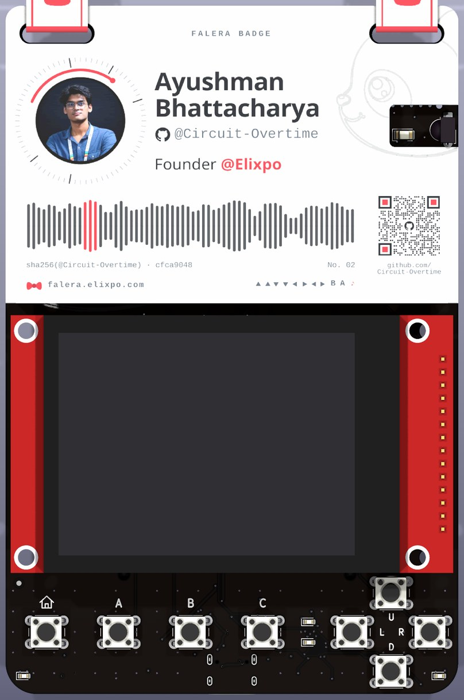
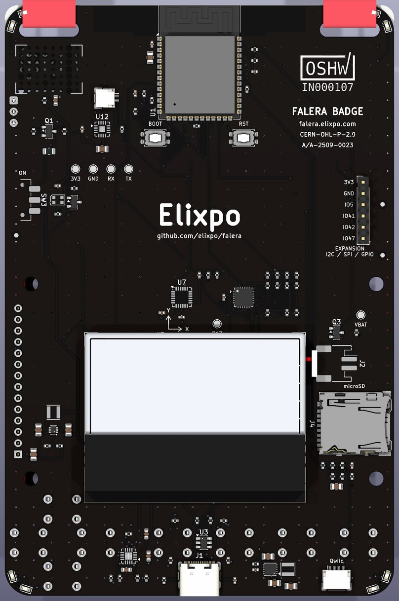

# Falera badge hardware

The Falera Badge is certified open source hardware by the Open Source Hardware
Association, UID [IN000107](https://certification.oshwa.org/in000107.html). The design is licensed under
CERN-OHL-P-2.0 (see `LICENSE` in this directory).

<p align="center">


</p>

This KiCad 10 project is the PCB successor to the ESP32-S3 DevKitC
breadboard: a 4-layer, 88 x 133.5 mm board, fully routed. The first five
boards were ordered in November 2026. The root
schematic, `elixpo.kicad_sch`, links five sheets:

1. ESP32-S3-WROOM-1-N16R8 module, reset and boot, debug pads.
2. USB-C, BQ24074 Li-ion power-path charger, battery sense and TPS63031 3.3 V rail.
   (The display's 5 V boost, U6, is on sheet 3.)
3. 2.8 inch ILI9341 SPI display module header and the eight buttons.
4. AW9523B I2C expander, the I2C bus, corner and edge LEDs.
5. MAX98357A speaker amp, MPU-6050, microSD, infrared, status LED, Qwiic and the
   J6 expansion header.

The renders, and the 3D model on the website's badge page
(`falera.elixpo/public/models/falera-badge.glb`), come from
`python3 circuit/elixpo/render_board.py`. They use the board stackup colours:
black mask, white silkscreen, HASL. The first five boards were made before the
rename, so their silkscreen still says OREO BADGE and oreo.elixpo.com; the
design files now say FALERA BADGE, falera.elixpo.com and
github.com/elixpo/falera.

They show the badge as it is worn: the display module on its header, a name
card on the front, the lanyard through the slots and the battery on the back.

- **Display module:** J3 (the header socket) carries a second 3D model,
  `3d/MSP2807.step`, made by `3d/make_msp2807_model.py` from LCDwiki's
  MSP2807 outline drawing (V1.0): red 50 x 86 x 1.6 mm PCB with its four
  3.2 mm holes, the 50 x 69.2 mm panel (0.5 mm tape, 2.3 mm LCD and
  backlight, 1.2 mm touch panel, 5.6 mm in all), the 43.2 x 57.6 mm active
  area, and the 14-pin header (2.54 mm plastic, pins 8.38 mm behind the PCB).
  Its origin is header pin 1 on the PCB's back face, and its offset is
  11 mm, the M3 standoffs. The microSD socket and SMD parts on the module's
  back are not modelled.
- **Name card:** a 0.3 mm photo-paper sheet cut to
  `circuit/card/name-card/template/name-card-mask.svg` (slots, IR notch), with
  its top-left corner on the board's. Its top edge rests on the board (the
  lanyard holds it there) and its 15 mm fold-back tab, folded under it along
  the fold line, stands straight down to the board and props the lower end
  up: the face tilts 14.3 degrees, its lower edge 15.0 mm above the board at
  board y 87.7, 1.6 mm below the display's face and 2.3 mm short of the
  module. It clears everything under it (closest: D2, 1.1 mm). Its picture
  is the person's card, `circuit/card/name-card/cards/<handle>.html`, printed
  by headless Chromium: the top 59.5 mm on the face, the bottom 15 mm on the
  tab's printed side.
- **Lanyard:** the 12 mm, 1 mm strap printed with
  `circuit/card/lanyard/lanyard-print-<theme>.svg`. Each end goes into its
  slot from the front, round the bar above the slot and back up behind the
  board, where it lies against the strap and is sewn; artwork x = 25 mm
  leaves the slot on the front. Above the badge the two sides turn 11 degrees
  in and stop 100 mm along the strap from the slot.
- **Battery:** on the back, a 6 x 34 x 50 mm 603450 pouch (rounded plan
  corners and edges) on the silkscreen outline (board x 60-110, y 104-138),
  with its lead plugged into J2, and the L-shaped holder: its foot on the
  solid outline below the cell (y 138.3-142.3, through H5-H6), its wall as
  tall as the cell and its lip reaching 11 mm over it. No holder design file
  exists yet, so its 1.5 mm wall thickness is assumed. Nothing on the back
  sits under the cell or the holder.
- **Buttons:** the TS665CJ switches are 5.0 mm tall to the plunger; KiCad's
  SW_PUSH_6mm model is 4.3 mm, so the eight models are stretched to 5.0 mm
  (scale z 1.1628, also set by `generate_badge_pcb.py`).

```
python3 circuit/elixpo/render_board.py                      # renders and GLB
python3 circuit/elixpo/render_board.py --renders            # renders only
python3 circuit/elixpo/render_board.py --glb                # GLB only
    --card HANDLE         whose card (default Circuit-Overtime)
    --no-card             no card
    --lanyard-theme NAME  paper, butter, blush or bamboo (default: the card
                          owner's theme in circuit/card/name-card/people.json)
    --no-lanyard          no lanyard
    --no-battery          no battery and holder on the back
```

The card, the lanyard and the battery are not KiCad parts. In the GLB they
are meshes (the card and the strap textured) added to KiCad's export. For
the renders, which kicad-cli cannot texture, they are VRML models made of
0.1 mm (card) and 0.125 mm (strap) cells, one colour each (the battery in
plain colours), hung on G1 in a temporary copy of the board. The card and
the lanyard need a headless Chromium (`CHROME`, or Playwright's headless
shell) and `pdftoppm`. The badge page's viewer turns about the badge's own
centre (`camera-target` in `falera.elixpo/src/components/BoardViewer.tsx`),
so the straps do not pull it off centre.

Run `./circuit/elixpo/build.sh` from any directory to regenerate the design and
produce the ERC report, PDF and KiCad-native BOM under `circuit/elixpo/build/`.

`BOM_PROCUREMENT.csv` is the sourcing-oriented BOM. `BOM_PRELIMINARY.csv` is a
flat engineering export that is regenerated directly from the schematic model.
`BOM_ORDER.csv` is the shopping list generated from the schematic (see
Assembly below), and `BOM_COST.md` is the bill of materials for one badge
as it was actually ordered, with the cost of each part.

## Pin map

| GPIO | Net | GPIO | Net |
|---|---|---|---|
| 0 | BOOT button | 21 | TOUCH_IRQ (display touch) |
| 1 | VBAT_SENSE (ADC) | 38 | SD_CLK |
| 2 | IR_TX | 39 | SD_CMD |
| 3 | EXP_INT (AW9523B, RTC GPIO: wakes the badge) | 40 | SD_D0 |
| 4 | IMU_INT | 43, 44 | UART TX, RX (debug pads) |
| 5, 41, 42, 47 | J6 expansion header | 45, 46 | strapping pins, unused |
| 6, 7 | I2C SDA, SCL | 48 | STATUS_LED (WS2812B) |
| 8, 9, 10 | I2S BCLK, LRCLK, DIN | 11, 12, 13 | LCD MOSI, SCK, MISO (touch only) |
| 14, 15, 16, 17 | LCD CS, DC, RESET, backlight | 18 | IR_RX |
| 19, 20 | native USB D-, D+ | 35-37 | in-module octal PSRAM |

On the AW9523B (0x58): P0_0-P0_7 are UP, DOWN, LEFT, RIGHT, A, B, C,
HOME; P1_0-P1_3 sink the corner LEDs (TL, TR, BL, BR); P1_4 AMP_EN,
P1_5 SD_DET, P1_6 AUX_ON_N (low turns on +3V3_AUX), P1_7 the touch
controller's chip select. Other
I2C devices: MPU-6050 0x69 (AD0 tied to its VLOGIC pin;
`oreoWare/imu.py` tries 0x68, then 0x69).

This differs from the breadboard's `oreoWare/pins.py` (buttons on GPIOs,
SD on 38-40, the amp on 41/21/46): the expander freed the button pins, so
the PCB regroups them. The OS needs a matching pin map, an ILI9341 driver,
a touch driver and the expander button driver (#154) before it runs on
this board.

## Electrical decisions

- 4 layers, JLCPCB JLC04161H-7628 (1.6 mm): F signal / In1 solid GND /
  In2 signal with a 3.3 V pour / B signal.
- U1 is the ESP32-S3-WROOM-1-N16R8 module (16 MB flash, 8 MB octal PSRAM),
  its PCB antenna over a keep-out on every layer at the top edge.
- Native USB uses GPIO19/GPIO20, 22 ohm series resistors, Type-C 5.1 kohm Rd
  resistors and a dedicated low-capacitance ESD array.
- BQ24074 keeps the system powered while charging. The current design targets
  about 445 mA charge current, about 800 mA input limit, about 50 mA
  termination current, and a 6.3-hour safety timer (all JLCPCB basic resistor
  values). These values must be checked against the selected cell before
  production. The battery level comes from the R17/R18 divider on GPIO1 (ADC).
- The main 3.3 V rail is buck-boost regulated so the badge remains stable over
  the full Li-ion discharge curve. The speaker amp and the IR LED run from
  VSYS.
- The display module runs from its own 5 V rail (LCD_5V), made by U6, a
  TPS61023 boost from VSYS. Its backlight is fed straight from that pin, so a
  steady 5 V keeps it equally bright from a full cell down to the cut-off;
  from 3.3 V or from the battery directly it would dim as the cell drains.
  The module's own regulator makes 3.3 V for its logic, so the signals stay
  at 3.3 V. U6's output is disconnected from its input when it is off.
- The IR receiver and the status LED sit on +3V3_AUX, which Q4 switches
  off at power-up (R46 pulls its gate high). The OS drives P1_6 low to turn
  them on, and keeps GPIO48 low while they're off. With them off, standby
  is set by the ESP32's own sleep current.
- microSD is on its own 1-bit SDMMC bus (CLK 38, CMD 39, D0 40), as on the
  breadboard, so the display keeps the whole SPI bus for video. DAT1-DAT3
  are pulled up at the socket.
- J6 brings out GPIO5, 41, 42 and 47 with 3.3 V and GND on a 2.54 mm header
  for add-ons: any of them can be I2C, SPI or plain GPIO through the
  ESP32-S3's GPIO matrix. Qwiic (J5) carries the main I2C bus as well.
- There is no RTC: the ESP32's own clock keeps time while the battery is in,
  and the OS sets it over Wi-Fi (NTP) after a cold start.
- GPIO45 and GPIO46 are deliberately unused because they are boot strapping
  pins. GPIO0 has a dedicated BOOT switch and EN has the recommended
  10 kohm/1 uF reset network.

## On the first boards

- Check the display module's header order against J3, and the battery
  lead's polarity against J2.
- Check the module's mounting holes against H1-H4. LCDwiki's MSP2807
  drawing (V1.0) puts them 76.08 mm apart along the module; the board's are
  78.08 mm apart (H3 and H4 at x 122.08), so by the drawing the module's
  header-end holes sit 2 mm short of H3 and H4. The 3D model follows the
  drawing, so the renders show the offset.
- UP (SW11) is hard to press: its plunger is 5.0 mm up, 11.6 mm below the
  screen face, with its centre 3.9 mm from the module's edge under the
  module's 6 mm overhang (11 mm standoffs). An adult fingertip only catches
  it at an angle. Version 2 fixes it by making the board 10 mm longer,
  added below the screen: the D-pad moves clear of the module, and the room
  also takes the aux jack and the RTC and fuel gauge coming back. The card
  template and the lanyard slots don't change, since the length goes below
  the screen.
- Confirm the selected LiPo capacity, protection board and maximum permitted
  charge current (#156).
- Review the ESP32-S3 RF layout against Espressif's current hardware guide;
  tune the antenna network on assembled boards with a VNA.
- Replace the MPU-6050 only if its successor driver is added to FaleraOS first.
- Treat this as an engineering prototype, not a production-certified charger
  or RF design, until bring-up and compliance testing complete.

## Display mounting

The display is a 2.8 inch 240x320 ILI9341 SPI module of the LCDwiki MSP2807
type (86 x 50 mm, with XPT2046 resistive touch and its own regulator and
backlight transistor). It sits landscape on the front, under the name card,
with its 14-pin 2.54 mm header in J3 (a hand-soldered socket) on the right
and its four M3 holes on 11 mm standoffs in H1-H4. LED (pin 8) is a logic
input, so GPIO17 drives and dims the backlight directly. Touch shares the
display's SPI bus, with T_CS on the expander's spare pin (EXP_P17) and
T_IRQ on GPIO21.

Before soldering J3, check that the module's header reads VCC, GND, CS,
RESET, DC, SDI, SCK, LED, SDO, T_CLK, T_CS, T_DIN, T_DO, T_IRQ from pin 1:
clones differ.

## Ordering the boards

`python3 export_jlcpcb.py` writes `build/jlcpcb/oreo-badge-gerbers.zip`.
The first boards were ordered from JLCPCB with these options:

| Option | Setting |
|---|---|
| Layers, thickness | 4, 1.6 mm, FR-4 TG135, no stackup requirement |
| Copper | 1 oz outer, 0.5 oz inner |
| Mask, silkscreen | black, white |
| Surface finish | HASL (lead-free for boards that are sold) |
| Vias | 0.3 mm drill, 0.4/0.45 mm pad, plugged |
| Mark on PCB | Remove Mark (the board has no order-number placeholder) |
| Electrical test | flying probe, fully tested |
| PCB assembly, stencil | off |

## Assembly

The first badges are assembled by hand from bare boards. The parts come from
LCSC, apart from the display, the MPU-6050, the battery and the screws;
`BOM_COST.md` lists every part as ordered, including the in-stock
replacements used for the parts LCSC had run out of. The chips with an
exposed pad (BQ24074, TPS63031, TPS61023, AW9523B, MAX98357A, MPU-6050) and
the two inductors need solder paste and hot air or a hot plate; everything
else, including the through-hole buttons, J3 and the IR receiver, is
soldered with an iron. The corner LEDs D1-D4 on the front stay SMD; each has
two more on the back's corner curve (D30-D37), in parallel on the same
AW9523B channel. The speaker's wires solder to J7's pads if it has no
JST-SH plug.

`export_jlcpcb.py` also writes a JLCPCB assembly BOM and placement list in
`build/jlcpcb/` holding only parts from JLCPCB's basic library (all on the
back, so assembly is single-sided), for anyone who wants JLCPCB to fit
those. `BOM_ORDER.csv` lists everything a badge needs: what JLCPCB can fit,
the SMD and through-hole parts to solder by hand, and the off-board parts,
with LCSC numbers and prices.

FaleraOS and its firmware are flashed over USB-C once a board is assembled;
the OS first needs this board's pin map, an ILI9341 driver, a touch driver
and the expander button driver (#154).

The battery sits on the back in a 3D-printed L-shaped holder: it runs the
cell's 50 mm edge, is as tall as the cell (6 mm) and has a 10-12 mm lip over
it. Its foot is drawn on the back silkscreen under the cell and fixes with
two M2 screws in H5-H6; the dashed line shows how far the lip reaches.

## Motion sensor orientation

U7 (MPU-6050) is on the back, unrotated, so seen from the front its +X
points to the left of the screen, +Y up the screen and +Z into the badge,
the frame oreoWare/imu.py and oreoWare/pins.py assume.

## Contributing

Open work is labelled
[hardware](https://github.com/elixpo/falera/issues?q=is%3Aopen+label%3Ahardware),
and new ideas go in the
[hardware issue form](https://github.com/elixpo/falera/issues/new?template=hardware.yml).
In short:

- Change the schematic by changing `generate_badge_schematic.py`, then run
  `build.sh` and commit what it writes. Edits made only in the schematic
  editor are lost on the next run.
- The board is built by scripts, run with `/usr/bin/python3` (KiCad's
  pcbnew): `generate_badge_pcb.py` places the parts, draws the outline and
  the silkscreen; `route_badge_pcb.py` routes with Freerouting;
  `finish_badge_pcb.py` adds ground stitching and closes the last gaps;
  `tighten_regulator.py` packs the 3.3 V regulator. Running
  `generate_badge_pcb.py` again discards the routing, so small changes to a
  routed board go in with a script or by hand in KiCad.
- `wire_side_schematics.py` draws the wired front and back schematics, and
  `export_jlcpcb.py` writes the order files.
- CI (`.github/workflows/hardware.yml`, KiCad 10.0.5) fails if the committed
  schematic differs from the generator, if ERC reports anything, or, once
  the board has footprints, if DRC or schematic parity fails. Its artifact
  holds the schematic PDF, the BOM and the reports.
- A pin change also changes `oreoWare/pins.py`, the drivers and
  `docs/HARDWARE.md` in the same pull request.

The full guide is the
[hardware section of CONTRIBUTING.md](../../CONTRIBUTING.md#work-on-the-hardware).

## Fund the badge

The first boards are paid for out of pocket. To help build them, chip in at
[payouts.elixpo.com/f/falera-badge](https://payouts.elixpo.com/f/falera-badge).

## Credits

The Falera badge is designed by Ayushman Bhattacharya
([@Circuit-Overtime](https://github.com/Circuit-Overtime)) with Anwesha
Chakraborty ([@anwe-ch](https://github.com/anwe-ch)), Elixpo core maintainer,
who co-authored the JLCPCB order files (#173) and the RV565 video format the
badge plays.

## Licence

The hardware design files in this directory are Open Hardware, licensed under
the [CERN Open Hardware Licence v2 - Permissive](../../LICENSES/preferred/CERN-OHL-P-2.0)
(CERN-OHL-P-2.0); see [`LICENSE`](LICENSE) for the notice. You may make,
modify and sell boards from them; the Elixpo and Oreo names and mascot are
trademarks, so derived boards need their own names (see
[`TRADEMARKS.md`](../../TRADEMARKS.md)).
