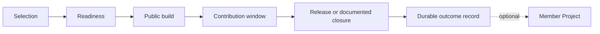

## What Elixpo is

**{{ONE_LINE_DESCRIPTION}}**

> **{{PUBLIC_LINE}}**

{{FULL_DESCRIPTION}}

Projects come to Elixpo to ship their next chapter—not archive their last one.
Elixpo is not a SaaS portfolio, passive project directory, license authority,
repository graveyard, or promise of permanent maintenance. Its services and
infrastructure support public building and release work.

  

## Projects, Research, and Services

{{PUBLIC_FAMILIES}}

Packages are a distribution surface for Open Projects, not a fourth family.
Lifecycle describes the state of the work; Core, Chapter, Member, and Connected
describe its relationship to Elixpo.

## How an Elixpo Chapter works

A Chapter is a time-bounded public build-and-release cycle. It starts with an
active maintainer, a credible artifact or prototype, and one meaningful next
objective. It ends with a release, prototype, report, package, or an explicit
documented closure.

Repository transfer is not required. A project may remain with its owner while
participating in a Chapter. Member Project status is an ongoing relationship
earned through successful collaboration; it does not automatically transfer
copyright, trademarks, packages, domains, or project authority.

## Current public work

This directory is generated from the canonical registry. It includes every
non-archived public entry and states lifecycle separately from relationship.
Feature placement is editorial and does not change these records.

{{CURRENT_DIRECTORY}}

Registry snapshot: **{{REGISTRY_DATE}}**. Archived work remains visible in the
[GitHub organization](https://github.com/orgs/elixpo/repositories?q=archived%3Atrue)
as history, not as currently supported work.

## Specialized publication surfaces

The main portal remains the organization directory and canonical source for
classification, lifecycle, relationships, and cross-project links. Two
specialized repositories operate deeper publication surfaces:

- [`packages.elixpo`]({{PACKAGES_URL}}) owns package building, signed APT
  distribution, release artifacts, installers, and the package catalogue.
- [Elixpo Research]({{RESEARCH_PUBLISHER_URL}}) is the standalone publication
  surface for papers, citations, datasets, models, demonstrations, and
  reproducibility records. The [portal research directory]({{RESEARCH_INDEX_URL}})
  provides the organization-level classification and links each record to its
  canonical publication. Research code and primary evidence stay in their
  owning project repositories.

The specialized sites must consume the shared schema or synchronize changes
through reviewable pull requests. They do not maintain independent
organization directories, silently change lifecycle status, or replace the
owning repository as the source of technical evidence.

## Participate

- **Contribute to a project:** use the owning repository's contribution guide,
  current issues, and maintainer review process.
- **Follow current conversation:** use the moderated
  [Elixpo community index]({{COMMUNITY_URL}}) or open the canonical forum on
  GitHub. The website's latest feed is activity-ordered and is not an editorial
  endorsement.
- **Discuss a Chapter:** start with [Elixpo Discussions]({{DISCUSSIONS_URL}}) and
  describe the working artifact, accountable maintainer, next release objective,
  and availability to review contributions. A discussion is not automatic
  acceptance or a request to transfer the repository.
- **Follow Chapter operations:** use the
  [Elixpo Chapter repository]({{CHAPTER_URL}}).
- **Explore installable work:** visit [Elixpo Packages]({{PACKAGES_URL}}).
- **Follow research:** browse the [organization research
  directory]({{RESEARCH_INDEX_URL}}), then open the canonical paper,
  experiment, model, or proposal record on
  [research.elixpo.com]({{RESEARCH_PUBLISHER_URL}}).

## Evidence, credit, and history

Credit should point to attributable work—merged changes, reviews, releases,
research, design, documentation, or community operations. Repository history is
the current evidence source. The [People record]({{PEOPLE_URL}}) separates
current organization responsibility from project maintenance, alumni, advisors,
and community contribution. The [contributor records]({{CONTRIBUTORS_URL}})
describe attributable public outcomes without presenting a commit total as a
measure of human value. The [organization timeline]({{HISTORY_URL}}) states date
precision and links the public evidence for every milestone.

  

Unknown role dates and empty role categories remain explicit. Elixpo does not
infer employment, certification, permanent affiliation, review, or consent for
a private biography from a public contribution.

## Funding boundary

Elixpo does not currently solicit, accept, hold, or route organization-level
sponsorship funds. Independently governed projects may publish their own funding
routes under their own authority and accounting; listing through Elixpo does
not make Elixpo the recipient or intermediary. Funding does not purchase Chapter
selection, feature placement, research conclusions, contributor credit,
governance authority, or favourable editorial treatment.

## Licensing and brand use

Licenses vary by project and artifact. The terms in the owning repository or
artifact record control, and existing work is not silently relicensed when it
joins Elixpo. New Elixpo-owned code defaults to MIT, with Apache-2.0 available
where its patent grant is useful; papers and general documentation default to
CC BY 4.0; new hardware source defaults to CERN-OHL-S-2.0. Datasets, models,
weights, and brand assets require artifact-specific review.

Copyright permission does not grant permission to impersonate Elixpo or claim
endorsement. The canonical brand destination is the
[Elixpo asset library]({{ASSETS_URL}}). Colour tokens, typography guidance, and
general usage guidance are public. Official sticker artwork is shown only as a
watermarked preview; print-ready files or physical packs are released through
an approved written event partnership. Accurate referential use and protected
uses are defined by the published [trademark and brand-use policy]({{TRADEMARK_POLICY_URL}}).

---

[Website]({{WEBSITE_URL}}) · [GitHub]({{GITHUB_URL}}) ·
[Discussions]({{DISCUSSIONS_URL}}) · [Chapter]({{CHAPTER_URL}}) ·
[Research]({{RESEARCH_INDEX_URL}}) · [Packages]({{PACKAGES_URL}}) · [People]({{PEOPLE_URL}}) ·
[History]({{HISTORY_URL}})
