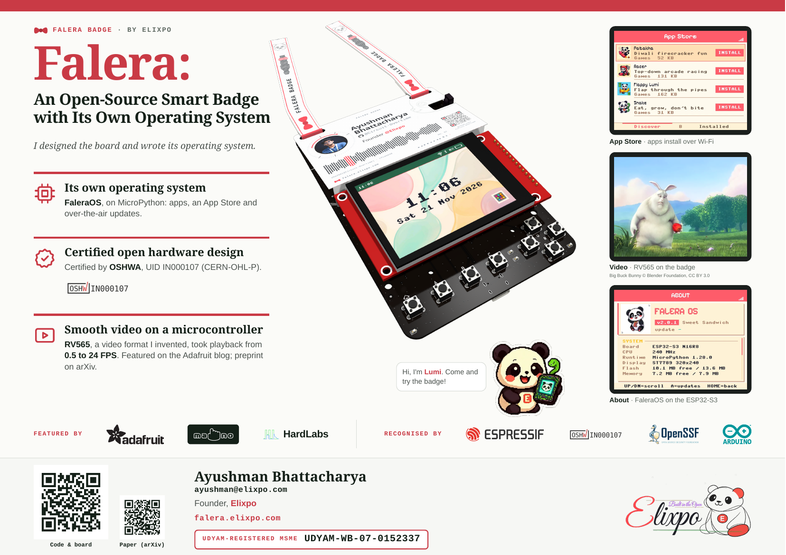

# ABP Infocom 2026: poster, cards and the pitch

For the JIS University stall at ABP Infocom 2026, Hyatt Regency, Kolkata,
28 November 2026. Project title (official, from the nomination):
**"Falera: An Open-Source Smart Badge with Its Own Operating System"**.



The poster is **generic**: no event or university branding (no JIS University
logo, no event name), so it can be reused at any event. The QR cards, the
funding card and the pitch are generic too.

## Print files (`out/`)

| File | What |
| --- | --- |
| `poster-a3.pdf` | A3 landscape, 420 × 297 mm, no bleed |
| `poster-a3-bleed3mm.pdf` | the same with 3 mm bleed on every side (426 × 303 mm), if the print shop asks |
| `poster-a3-cmyk.pdf` | the no-bleed poster converted to CMYK (made by `make_poster.py`, not in git) |
| `qr-cards-a4.pdf` | ten 85 × 55 mm QR cards on A4, with crop marks |
| `funding-card.pdf` | A5 portrait card for the table: the fundraiser QR (payouts.elixpo.com/f/falera-badge), what each amount buys, sponsor levels |
| `cue-cards-a4.pdf` | four A6 pocket cue cards: the opener and close, and the three pitches |
| `*-preview.png` | previews at 100 dpi |

Images print above 300 dpi: the hero at 372 dpi, the three screenshots at
917 dpi (UI screens enlarged 4x pixel for pixel), Lumi (pixel art, tripled)
at 713 dpi, the logos above 500 dpi. Both QR codes decode from
a 300 dpi raster of the RGB and the CMYK PDF; the main one is 40 × 40 mm.

## The demo and the laptop

[DEMO.md](DEMO.md): the one focused demo (about 3 minutes): a computer you
can wear round your neck, why, the three layers, examples, remote control
over USB with `falera transfer`, the paper, the video, and the ask; with
what to say, what to show on the badge and which screen to show at each
step, and what to do if something goes wrong.

[stall-screen.html](stall-screen.html): the laptop's full-screen page, scaled
to any screen. Keys 1 to 5: the overview, the three layers, what it does
(updates over the air, infrared, the RV565 video format), the research
paper, and star and back it (QR codes).

## The pitch

[PITCH.md](PITCH.md): a five-second opener, three 30-second pitches to pick by
mood (A "It's a computer", B "The video trick", C "Open, and built here"),
the funding close, quick answers and a don't-say list.

## Sources

| File | What |
| --- | --- |
| `poster.html` | the poster, in millimetres; edit the text here. Left: title and highlights; centre: the badge in 3D and Lumi; right: three FaleraOS screens (App Store, video, About); a "Featured by / Recognised by" row; footer: QR codes, name and email, the team, logos |
| `cards.html` | the QR card (one `<template>`, repeated ten times) |
| `funding-card.html`, `cue-cards.html` | the funding card and the cue cards |
| `make_poster.py` | prints both to PDF, makes the bleed and CMYK copies and the previews |
| `make_qr.py` | writes `assets/qr-github.svg`, `assets/qr-arxiv.svg` and `assets/qr-fund.svg` |
| `render_hero.py` | renders the badge in 3D (kicad-cli, 3000 px, transparent), with Ayushman's card and the lanyard, from `circuit/elixpo/render_board.py`'s models |
| `assets/jis_university_logo.png`, `assets/elixpo_lock_up_text_mascot.png` | the official logos, as provided |
| `assets/elixpo-lockup-clean.png` | the Elixpo lock-up with its off-white background removed and cropped (the drawing untouched), so it sits on the poster's paper |
| `assets/screen-*.png` | FaleraOS screenshots (falera.elixpo/public/screens), 4x; the video frame is Big Buck Bunny, © Blender Foundation, CC BY 3.0, credited on the poster |
| `assets/press/*.svg` | the official Adafruit, Arduino and OpenSSF logos (Wikimedia Commons) and Espressif's (espressif.com), and MA-NO's and HardLabs' as provided (MA-NO's white logo sits on a dark tile; HardLabs' is 64 px, so it's a 9 mm icon beside the name), for the "Featured by / Recognised by" row. The row follows falera.elixpo/src/data/press.ts |
| `compose_hero.py` | puts FaleraOS's real home screen on the display (exact perspective) and drops kicad-cli's ground shadow → `assets/hero-final.png` |

```
python3 render_hero.py      # only if the board changes (about a minute)
python3 compose_hero.py     # needs opencv-python
python3 make_qr.py          # needs qrcode
python3 make_poster.py      # needs headless Chromium, Ghostscript, pdftoppm
```

## Claims on the poster

They follow the rules from the handoff: "0.5 to 24 FPS" is the standalone
firmware path (inside FaleraOS it is 12.2 FPS, never claimed here); Adafruit
*featured* RV565; the paper is an arXiv *preprint*; OSHWA certified the
*board design* (IN000107, CERN-OHL-P). RV565 on CircuitPython is left off.

## Before printing

- [ ] Ask the print shop: bleed or no bleed, RGB or CMYK PDF.
- [ ] Scan both QR codes from the printed proof.
- [ ] Print by 27 November: A3 on thick or laminated paper, or on foam
      board / in a clip frame; 20 to 30 QR cards (two or three A4 sheets).
