# Mermaid Support

LixSketch imports Mermaid the way Excalidraw's *Mermaid to Excalidraw* does:

- **Native** diagram types become ordinary, editable LixSketch shapes. Every node, message, class and relation is its own rectangle, circle, line or arrow, placed in a frame. You can restyle, move and reconnect the result like anything you drew by hand.
- **Every other** Mermaid type is rendered by the real Mermaid library and inserted as one image.

---

## Importing Mermaid

1. Click the violet star in the toolbar to open **DSL Studio**.
2. Choose the **Mermaid** tab.
3. Type or paste Mermaid source, or pick a *Quick example*. A live preview renders on the right. Under the preview, a note says whether the source will place **editable shapes** or **an image rendered by Mermaid**.
4. Click **Place on Canvas** or press `Ctrl+Enter`.

The diagram lands centred on the current view, and one undo step (`Ctrl+Z`) removes it.

**Errors.** If the source is invalid, the preview shows the error with its line, for example:

```text
Parse error on line 3: Unclosed node shape: missing ']' in "C[unclosed --> D"
```

When the Mermaid library is loaded, its own parser messages are shown, such as `Parse error on line 2: … Expecting 'SEMI', got …`.

Mermaid blocks inside the **document editor** (the Docs panel) are rendered by the document editor itself and are not covered here.

---

## Support matrix

The type is read from the first line that is not empty and not a `%%` comment. YAML front matter (`---` … `---`) and `%%{init: …}%%` directives are skipped.

| Diagram | First line | Path | Result |
|---------|------------|------|--------|
| [Flowchart](#flowcharts) | `flowchart`, `graph` | **native** | Shapes, arrows, nested frames for subgraphs |
| [Sequence](#sequence-diagrams) | `sequenceDiagram` | **native** | Participants, lifelines, activations, messages, notes, blocks |
| [Class](#class-diagrams) | `classDiagram` | **native** | Class boxes, relation arrows, namespace frames |
| [Entity relationship](#entity-relationship-diagrams) | `erDiagram` | **native** | Entity headers with attribute rows, crow-foot relations |
| [Pie](#pie-and-xy-charts) | `pie` | **native** | Slices and legend |
| [XY chart](#pie-and-xy-charts) | `xychart-beta` | **native** | Bars or lines, axes, legend |
| State | `stateDiagram`, `stateDiagram-v2` | image | SVG rendered by Mermaid |
| Gantt | `gantt` | image | |
| User journey | `journey` | image | |
| Mindmap | `mindmap` | image | |
| Timeline | `timeline` | image | |
| Git graph | `gitGraph` | image | |
| Quadrant | `quadrantChart` | image | |
| Sankey | `sankey-beta` | image | |
| Requirement | `requirementDiagram` | image | |
| C4 | `C4Context`, `C4Container`, `C4Component`, `C4Dynamic`, `C4Deployment` | image | |
| Block | `block-beta` | image | |
| Packet | `packet-beta` | image | |
| Architecture | `architecture-beta` | image | |
| Kanban | `kanban` | image | |
| Radar / Treemap | `radar-beta`, `treemap-beta` | image | |
| ZenUML | `zenuml` | image | |

**Fallback.** If a native type uses syntax the native importer cannot read but Mermaid accepts, the diagram is placed as an image instead. The preview note then says *syntax beyond the native importer*.

**Images.** Rendered SVGs are embedded as `data:image/svg+xml` images (wider than 1200 px are scaled down) and keep their Mermaid source in a `data-mermaid-source` attribute. They follow the theme that was active when they were placed.

**The Mermaid library** (v11) is loaded only when the Mermaid tab is used, so it adds nothing to page load. Embedders of the `@elixpo/lixsketch` engine enable the image path with `window.__setMermaidLoader(() => import('mermaid'))`. Without a loader, native types still work and image-only types report that the renderer is unavailable.

---

## Flowcharts

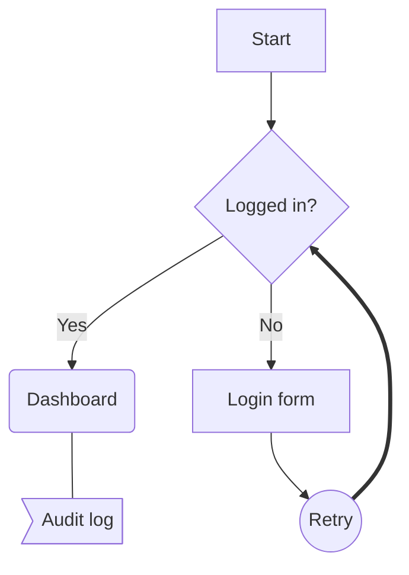

### Directions

`TB`/`TD` (top to bottom), `BT`, `LR` and `RL`. `BT` is drawn as `TD` mirrored vertically, and `RL` as `LR` mirrored horizontally. Without a header the source is read top-down.

Nodes are laid out in layers along the flow. Cycles are broken for ranking only, nodes in a layer are ordered to reduce crossings, and longer arrows (`--->`) skip a layer per extra dash.

### Node shapes

| Mermaid | Shape | Canvas |
|---------|-------|--------|
| `A[text]` | rectangle | Rectangle |
| `A(text)` | rounded | Rectangle with rounded corners |
| `A([text])` | stadium | Rectangle with fully rounded ends |
| `A[[text]]` | subroutine | Rectangle + two inner vertical lines (grouped) |
| `A[(text)]` | cylinder / database | Rectangle + elliptical cap (grouped) |
| `A((text))` | circle | Ellipse |
| `A(((text)))` | double circle | Two concentric ellipses (grouped) |
| `A{text}` | rhombus / decision | Square rotated 45° |
| `A{{text}}` | hexagon | Rectangle (fallback) |
| `A[/text/]`, `A[\text\]` | parallelogram | Rectangle (fallback) |
| `A[/text\]`, `A[\text/]` | trapezoid | Rectangle (fallback) |
| `A>text]` | asymmetric | Rectangle (fallback) |
| `A@{ shape: cyl, label: "DB" }` | Mermaid 11 shape names (`rect`, `rounded`, `stadium`, `subproc`, `cyl`, `circle`, `dbl-circ`, `diam`, `hex`, `lean-r`, `lean-l`, `trap-b`, `trap-t`, …) | as above; unknown names fall back to Rectangle |

As in Excalidraw, geometry without a LixSketch primitive falls back to a rectangle. The preview draws the same shapes the canvas gets.

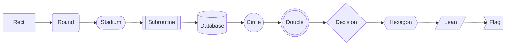

### Edges

| Syntax | Meaning | Canvas |
|--------|---------|--------|
| `A --> B` | arrow | Arrow bound to both nodes |
| `A --- B` | open link | Line (not bound) |
| `A -.-> B`, `A -.- B` | dotted | Dash `5 3` |
| `A ==> B`, `A === B` | thick | Stroke width 3 |
| `A ~~~ B` | invisible link | Not drawn (still affects layout) |
| `A --o B` | circle end | Arrow with a circle head |
| `A --x B` | cross end | Arrow with a cross head |
| `A <--> B`, `A o--o B`, `A x--x B` | both ends | One arrow with a head at each end |
| `A ---> B`, `A -..-> B`, `A ===> B` | longer | Same edge type spanning extra layers |
| `A --> A` | self loop | Curved arrow from the right side to the top |

**Labels.** Both label syntaxes work on every edge type: the pipe form `A -->|yes| B` and the inline form `A -- yes --> B`, `A == yes ==> B`, `A -. yes .-> B`.

**Chains and fan-out.**
- `A --> B --> C` creates one edge per step (N−1 edges).
- `A & B --> C & D` creates every pair, here four edges.

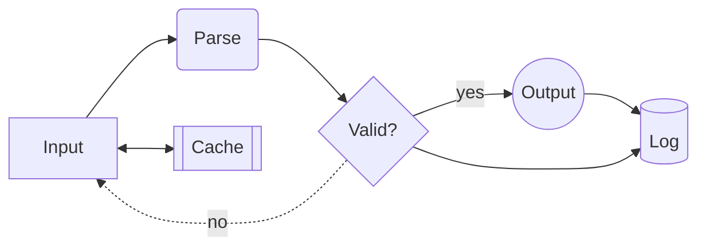

### Subgraphs

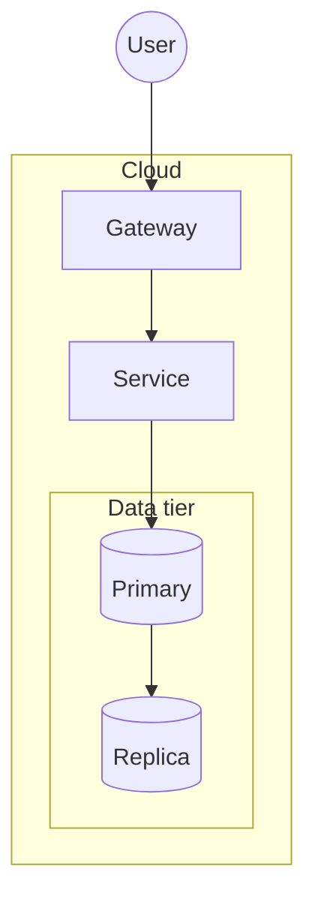

- **Forms.** `subgraph id`, `subgraph id [Title]` and `subgraph "Title"`, each closed by `end`.
- **Frames.** Every subgraph becomes a frame that contains its nodes. Nested subgraphs become nested frames.
- **Edges.** An edge is placed in the innermost frame that contains both of its ends.
- **Edge to a subgraph id.** It connects to the subgraph's first node.
- **`direction` inside a subgraph** is read but the layout uses the diagram's direction.

### Styling

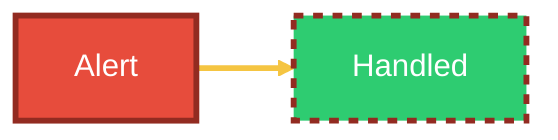

| Mermaid | LixSketch property | Default |
|---------|-------------------|---------|
| `fill` | `fill` (solid) | Theme palette, cycled per node |
| `stroke` | `stroke` | Palette stroke |
| `stroke-width` | `strokeWidth` | `1.5` (edges: 1.5, thick 3) |
| `stroke-dasharray` | `strokeDasharray` | none (dotted edges `5 3`) |
| `color` | label colour | Black or white, whichever contrasts with the fill |

- **Where styles come from.** `classDef` (including `classDef default`), `class a,b name`, the `A:::name` shorthand and `style id …` apply to nodes and subgraphs. `linkStyle 0,2 …` and `linkStyle default …` apply to edges by their order in the source.
- **Precedence.** `style` overrides `class`, which overrides `default`.

### Text

- Markdown strings ``"`**bold** _italic_`"`` keep their text without the markup.
- `<br>` and `<br/>` become line breaks.
- Entity codes `#quot;`, `#amp;`, `#lt;`, `#gt;`, `#35;` are decoded.
- `%%` comment lines are ignored, and so are `click`, `href`, `call`, `accTitle` and `accDescr`.
- Statements may be separated by `;`.
- A front-matter `title:` names the frame.

---

## Sequence diagrams

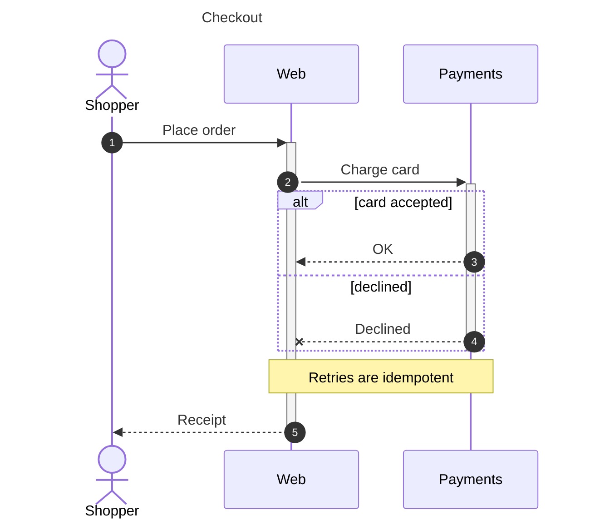

| Syntax | Canvas |
|--------|--------|
| `participant A`, `participant A as Label`, `actor A` | Labelled box at top and bottom with a dashed lifeline; actors are stick figures |
| `create participant X` / `destroy X` | Box appears at its creation message; lifeline ends in a red cross |
| `box Color Label … end` | Coloured panel behind the grouped participants |
| `->>` `-->>` | Arrow, solid / dashed |
| `->` `-->` | Line without head, solid / dashed |
| `-x` `--x` | Arrow with a cross head |
| `-)` `--)` | Async arrow |
| `<<->>` `<<-->>` | One arrow with heads at both ends |
| `A->>A: text` | Self-message loop |
| `activate X` / `deactivate X`, `A->>+B` / `B-->>-A` | Activation bars, nested; messages start and end on the bar |
| `Note left of`, `Note right of`, `Note over A` / `over A,B` | Note rectangle |
| `loop`, `alt`/`else`, `opt`, `par`/`and`, `critical`/`option`, `break` | Dashed frame around the involved participants, with section dividers; nested blocks are inset |
| `rect rgb(…)` … `end` | Coloured background region |
| `autonumber`, `autonumber 10 5`, `autonumber off` | Numbered message labels |
| `title Text`, `title: Text` | Frame title |
| `accTitle`, `accDescr`, `link`, `links`, `properties`, `details` | Ignored |

Column spacing grows to fit the longest label between neighbouring participants. A line the parser does not understand is an error (`Parse error on line N: unrecognised statement …`). An unclosed block is an error too.

---

## Class diagrams

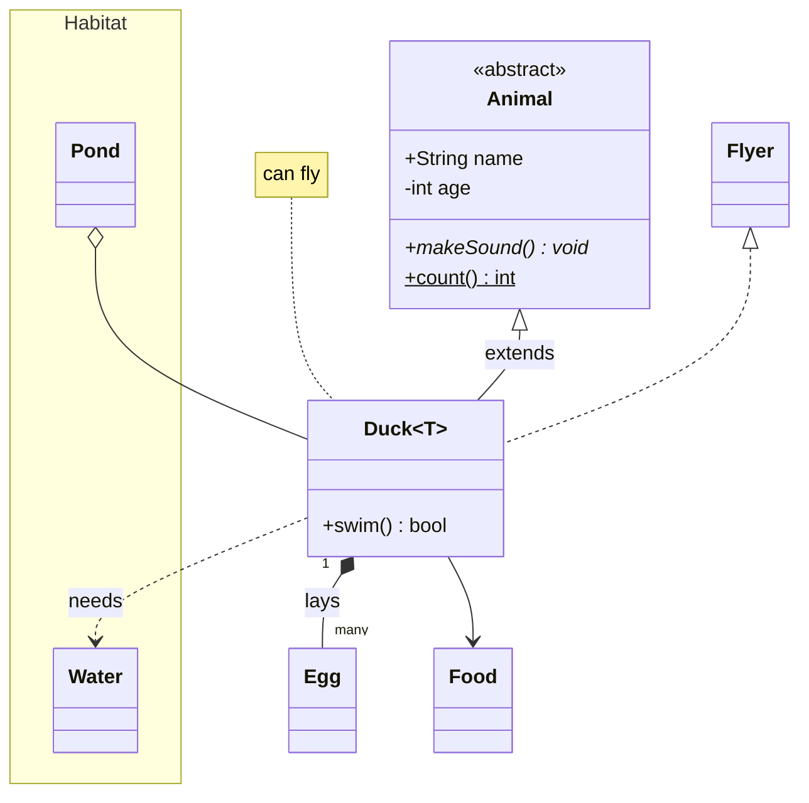

| Syntax | Canvas |
|--------|--------|
| `class Name { … }`, `Name : +member`, `class Name["Label"]` | Grouped stack: outline, name compartment, attributes, methods |
| Visibility `+ - # ~`, classifiers `$` (static) and `*` (abstract) | Shown on the member text |
| Generics `List~String~`, `class Duck~T~` | Shown as `List<String>`, `Duck<T>` |
| Annotations `<<interface>>` inside the class or `<<interface>> Name` | `«interface»` above the name |
| Relations (see below) | Bound arrows or lines |
| `namespace N { class … }` | Frame around its classes |
| `note for A "text"`, `note "text"` | Note rectangle (linked with a dotted line) |
| `direction LR` | Layout direction |
| `classDef`, `cssClass "A,B" name`, `class A:::name`, `style A fill:…` | Box colours |
| `click`, `link`, `callback` | Ignored |

Relations are one arrow from the first class to the second, with each UML marker drawn as the arrowhead at its end:

- **Inheritance** `A <|-- B` and **realization** `A <|.. B`: hollow triangle at A; realization is dashed.
- **Composition** `A *-- B`: filled diamond at A.
- **Aggregation** `A o-- B`: hollow diamond at A.
- **Association** `A --> B` and **dependency** `A ..> B`: open arrow at B; dependency is dashed.
- **Links** `A -- B` and `A .. B`: a line, solid or dashed.
- **Markers on both ends** such as `A <|--|> B`: one arrow with both heads.
- **Cardinality and label** `A "1" --> "*" B : label`: the arrow is labelled `1   label   *`.

The layout puts parents above children and wholes above parts. Relations bind to the whole class box, so moving a class drags its arrows.

---

## Entity relationship diagrams

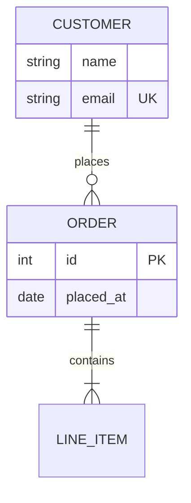

| Syntax | Canvas |
|--------|--------|
| `NAME { type name [key] }` | Header rectangle with one row rectangle per attribute |
| `A <card>--<card> B : label`, `A <card>..<card> B : label` | Arrow bound to both headers with crow's-foot heads, labelled `label` |

Cardinalities become crow's-foot arrowheads at each entity: `||` → one (`crowfoot_one`), `}|` / `|{` → one or many (`crowfoot_one_or_many`), `}o` / `o{` → many (`crowfoot_many`). Zero-or-one (`|o` / `o|`) uses the closest head, one.

Entities are laid out in a grid. Aliases (`A["Alias"]`), attribute comments and quoted entity names are not read by the native importer. When Mermaid accepts such a source, it is placed as an image instead.

---

## Pie and XY charts

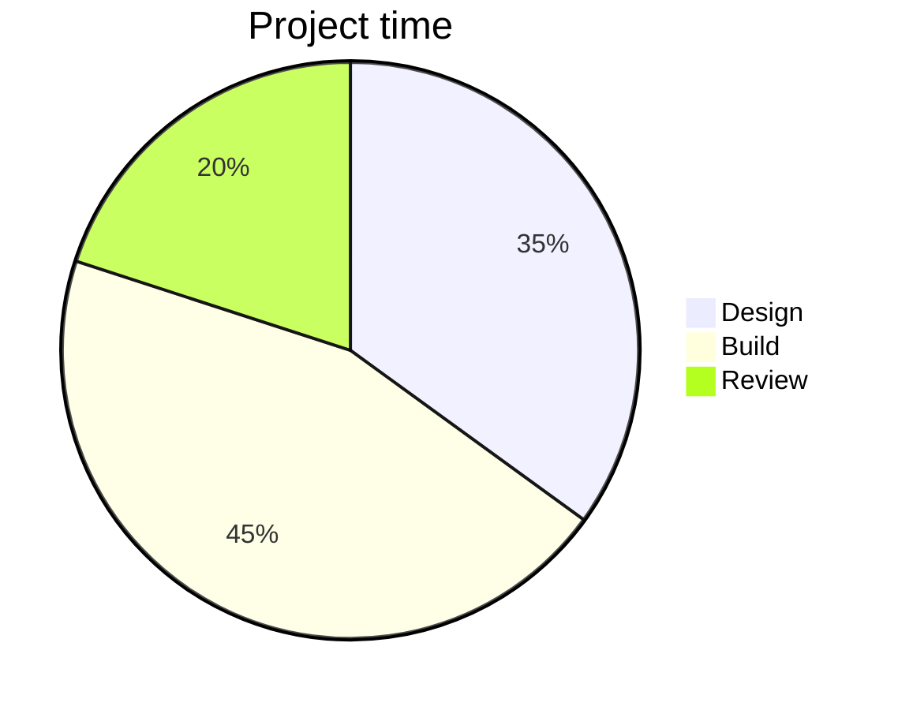

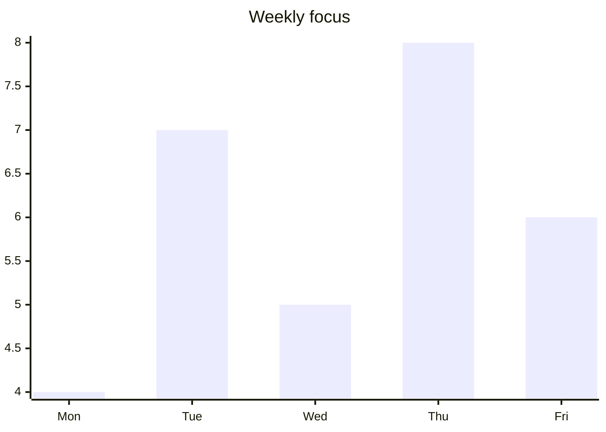

- **Pie.** Slices are drawn as filled strokes with a legend showing value and percentage.
- **XY axes.** `x-axis [..]` and `x-axis "Title" [..]` set the categories. `y-axis` is computed from the data.
- **XY series.** `bar` and `line` series may be named. When a chart mixes bars and lines, only the bars are drawn.

---

## Image-rendered types

Everything else is drawn by Mermaid itself and inserted as one image:

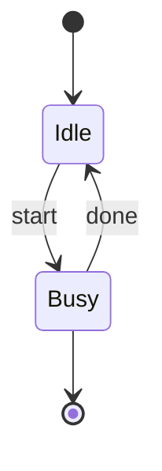

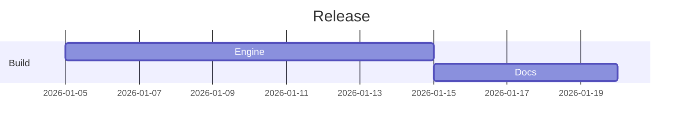

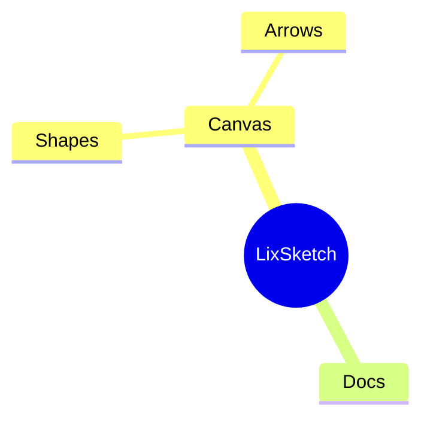

Image diagrams can be moved, resized and deleted like any image, but not edited shape by shape. To change one, edit the source and place it again.

---

## Limitations

- **Own parsers.** Native layouts are LixSketch's own (layered for flowcharts and class diagrams, column-per-participant for sequences, grid for ER), so positions differ from mermaid.js. Large diagrams may need tidying.
- **Straight edges.** Edges are drawn as straight segments between facing sides; there is no orthogonal routing.
- **Approximate geometry.**
  - Hexagons, parallelograms, trapezoids and flags are drawn as rectangles.
  - ER zero-or-one and zero-or-many have no separate "zero" ring; they use the one and many crow's feet.
- **No source link.** Placed shapes keep no link to the Mermaid source.
- **Theme at placement time.** Colours follow the theme that was active when the diagram was placed.

To keep a native diagram as editable text, export the canvas as a [`.lixsketch` file](/docs/lixsketch-dsl). Every shape created from Mermaid is written out as LixSketch DSL.
